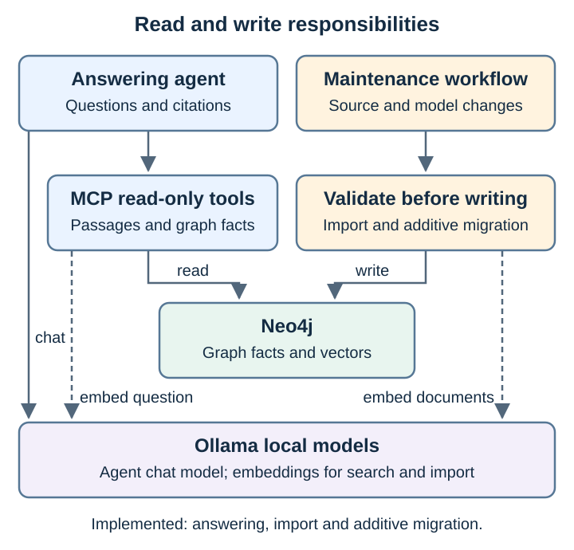

# Fully local Galaxium Travels GraphRAG

A local learning experiment: **LangChain answering agent → FastMCP read-only tools → Neo4j graph and vector retrieval**, with **Ollama** for chat and embeddings. Inference and retrieval use local services; the first setup downloads packages, images and models.

The fictional company data comes from the [original watsonx.ai example](https://github.com/thomassuedbroecker/galaxium-travels-graph-rag-watsonx-ai-example). Repository code, docs, diagrams and sample data are [Apache 2.0](LICENSE); depicted third-party interfaces retain their own rights. See [licenses and provenance](docs/licenses.md).

## Why a graph?

Ask *"Which destination can Galaxium Travels customers visit?"*. The curated graph represents the answer across two documents:

- `company-overview` says Galaxium Travels **OFFERS** Lunar Excursions.
- `lunar-itinerary` says Lunar Excursions **VISITS** the Moon.

Vector search finds passages; the graph hop through the shared `lunar-excursions` entity connects their facts. The passage text also mentions the Moon, so a correct answer alone does not prove graph use. In the recorded runs, the model skipped graph expansion and added unsupported destinations ([verification](docs/verification.md)). The labs also show how to **maintain** that graph when sources change: which data the insertion rules accept, why some data fits when it should not, and how to change the graph definition and migrate existing data.

## Labs

Work through the labs in order. Lab 1 installs and starts everything. Each lab shows the commands, the **expected result** of every step, and the versions before and after. Overview, version map and insertion rules: [labs/README.md](labs/README.md).

| Lab | Topic | Ontology | Facts after |
| --- | --- | --- | --- |
| [1](labs/01-initial-setup.md) | Initial setup | v1 | 4 |
| [2](labs/02-initial-question.md) | Initial data and initial question | v1 | 4 |
| [3](labs/03-add-fitting-data.md) | Add data that fits the data format; initial and new question | v1 | 5 |
| [4](labs/04-add-non-fitting-data.md) | Add data that does not fit; why one version still fits | v1 | 5 |
| [5](labs/05-update-graph-definition.md) | Update the graph definition; compare v1 and v2 | v1 → v2 approved | 5 |
| [6](labs/06-migrate-graph-data.md) | Migrate the existing graph data | **v2** | 5 |
| [7](labs/07-add-new-data.md) | Add the new data | v2 | 6 |
| [8](labs/08-all-questions.md) | Initial, new and newest question | v2 | 6 |

Data enters the graph only through `graphrag ingest` and `graphrag migrate`, which enforce fixed [insertion rules](labs/README.md#rules-for-inserting-data-into-the-graph). Free-form JSON is rejected.

## Limitations

This is the single list; other pages link here.

- **Curated input, not extraction.** `graphrag prepare` maps one known Markdown section with reviewed rules. No LLM extracts facts.
- **Validation checks structure, not truth.**
- **Tool use is prompted, not enforced.** See [Lab 2](labs/02-initial-question.md).
- **Read-only is a code boundary.** MCP and the importer share one Neo4j credential.
- **Migration is additive only.** Removed or redefined types and relations need a rebuild; there is no down-migration.
- **Not implemented:** document deletion, automatic relationship discovery, persisted approvals, chunking of large documents, concurrent importers.
- **Local, not air-gapped.** `start.sh --offline` refuses downloads, but this is not an audited air gap.

## Documentation

For a short read before the labs or alongside the blog post: read this overview, [ontology vs data model](docs/graphs/ontology-vs-data-model.md), and the [recorded results](docs/verification.md). Developers can then follow the component map; AI engineers can inspect tool traces and evaluation in the [developer guide](docs/development.md).

| If you want to… | Read |
| --- | --- |
| Learn step by step | [Labs](labs/README.md) |
| See how the data changes in each step | [Data lineage](docs/data-lineage.md) |
| Understand the graph, ontology and storage | [Graph versions](docs/graphs/README.md) |
| See components and design decisions | [Architecture](docs/architecture.md) |
| Change code, prompts or models | [Developer and AI engineer guide](docs/development.md) |
| Configure or troubleshoot | [Runtime reference](docs/reference.md) |
| Reproduce measurements | [Verification](docs/verification.md) |
| Check licenses | [Licenses and provenance](docs/licenses.md) |

`./scripts/test.sh` runs 24 local tests and skips the service test; `./scripts/test.sh --services` also runs that rerunnable integration test against the running Neo4j and Ollama.
