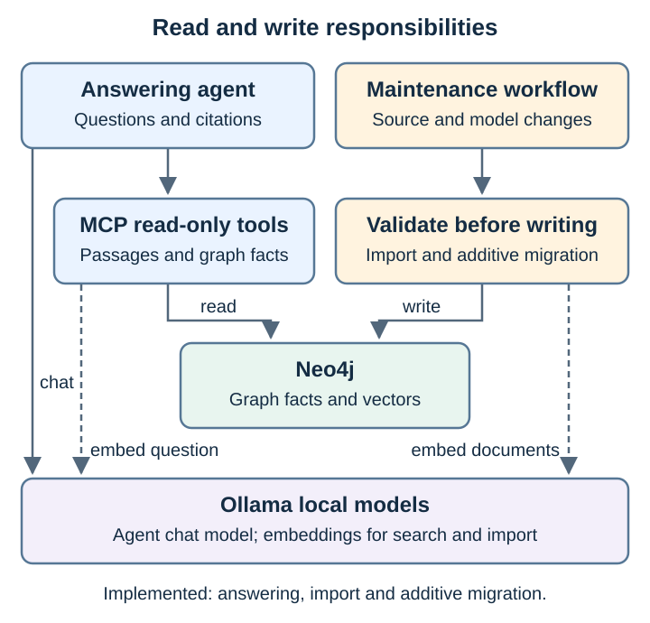
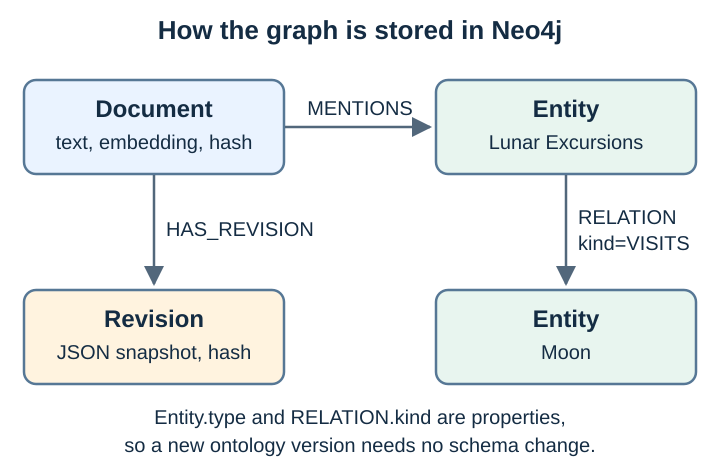
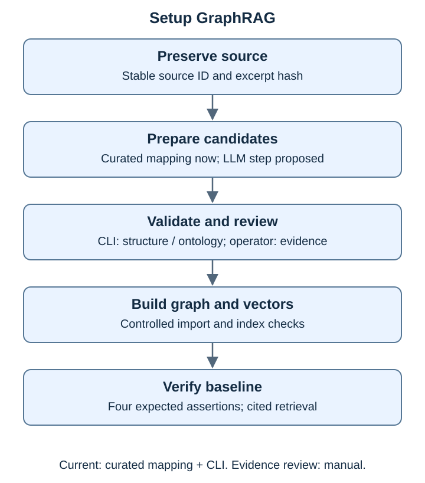
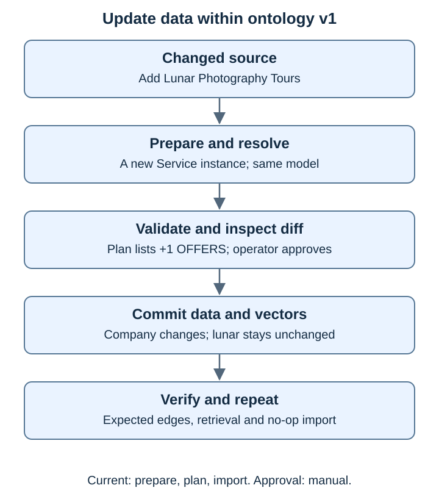
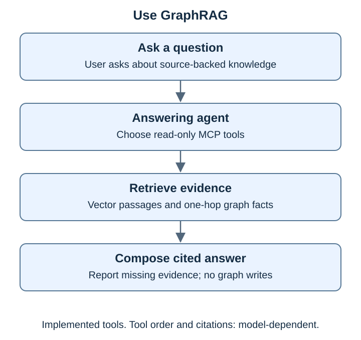

# Architecture

This page describes what is implemented and why. Possible extensions are listed in the [developer guide](development.md#possible-extensions). Limitations are listed once in the [README](../README.md#limitations).

## Principle: separate reading from writing

The answering agent **reads** knowledge. A separate, operator-driven maintenance path **prepares, validates and writes** it. A model proposal never grants permission to change the ontology or the database.

## Components

| Component | Responsibility | Code |
| --- | --- | --- |
| Answering agent | Pick tools, compose a cited answer. No write tools. | [agent.py](../src/local_graphrag/agent.py), [prompts.py](../src/local_graphrag/prompts.py) |
| Read-only MCP server | `search_documents(question, limit≤10)` and `graph_context(document_id)` (one hop, ≤50 facts) | [server.py](../src/local_graphrag/server.py), [store.py](../src/local_graphrag/store.py) |
| Preparer | Reviewed mapping of the company Markdown's *Primary Services* section to JSON documents | [prepare.py](../src/local_graphrag/prepare.py) |
| Validator | Reject fields outside the fixed document format, non-slug IDs and JSON passed as text; check types, relation endpoints, duplicate and conflicting IDs, `source_version` format and optional evidence quotes against the graph's active ontology | [data.py](../src/local_graphrag/data.py), [v1.json](../data/ontologies/v1.json) |
| Importer | Plan create/update/unchanged plus added/removed facts per document; embed changed documents; write them in one transaction | [store.py](../src/local_graphrag/store.py) |
| Neo4j 5.26 | Documents, entities, relations, vectors and revision snapshots | [compose.yaml](../compose.yaml) |
| Ollama | `qwen3:8b` chat, `nomic-embed-text` embeddings (768 dimensions) | runs on the host |

## Graph storage model

**Design decision: generic `Entity` and `RELATION`.** Domain types (Company, Service…) are the `Entity.type` property, and domain relations (OFFERS, VISITS) are the `RELATION.kind` property, not Neo4j labels or relationship types.

- *Why:* the ontology lives in a versioned JSON file and is enforced by the validator. Adding Training/REQUIRES in v2 needs no Neo4j schema change, and the one-hop expansion query works for any ontology.
- *Cost:* Cypher is less idiomatic (`[r:RELATION {kind:'OFFERS'}]` instead of `[:OFFERS]`) and Neo4j cannot use label indexes per type. Fine at demo size; revisit for large graphs.
- *Consequence:* storage accepts any `kind` between any entities, so the meaning and direction of each dependency are defined only by the ontology. See [ontology vs data model](graphs/ontology-vs-data-model.md).

## Workflows

### Setup and update under v1

`graphrag prepare` → `graphrag validate` → `ingest.sh` (plan with fact diff) → `ingest.sh --apply`. The [data lineage](data-lineage.md) shows the real data after each step. The importer:

1. validates **all** documents before touching the database;
2. compares each document's hash (content + embedding model + dimensions) with the stored one;
3. embeds only changed documents, **before** opening the write transaction;
4. in one transaction, replaces the facts and mentions owned by each changed document and keeps a content-addressed `Revision` snapshot;
5. rejects an existing entity ID whose name or type changed (the whole transaction rolls back).

A repeat import of identical data reports every document `unchanged` and writes nothing. `start.sh` reapplies the two baseline documents while the graph is on v1: it can undo the service update, but does not delete extra documents or revision history. On v2 it skips that import. Continue the labs without restarting between steps; use `stop.sh --delete-data` for a complete reset.

A new service name (Lunar Photography Tours) is a new **instance** of Service and fits v1. A new name is not a new type.

### Ask

The prompt asks for `search_documents` first, then `graph_context`, and to cite `document_id` and `source`. The model decides whether to follow it. Measured behaviour is in [verification](verification.md#recorded-run-13-november-2026).

### Data that needs a new ontology

A source says Lunar Excursions *requires* Lunar Surface Safety training. That needs a Training type and a REQUIRES relation, so v1 rejects it. Free-form JSON carrying the same information is rejected too: documents have a fixed set of fields. [v2](../data/ontologies/v2.json) adds exactly those two elements, is `approved` and `extends` v1.

The graph stores its active definition as an `Ontology` node; the importer validates against it, not against a built-in version. `graphrag migrate` refuses unless the target is approved, extends the active version and is additive. It then relabels and revalidates every current revision snapshot, writes new `Revision` nodes, and switches the active `Ontology` in one transaction. Embeddings are reused because the text does not change. Non-additive changes, simulation on a snapshot and approval records remain [possible extensions](development.md#possible-extensions). Walkthrough: [Labs 4–7](../labs/README.md).

## Security boundaries

- All endpoints must be loopback; Neo4j ports bind to `127.0.0.1` ([config.py](../src/local_graphrag/config.py), [compose.yaml](../compose.yaml)).
- MCP exposes no write or arbitrary-Cypher tool; tool inputs are length- and range-checked.
- The prompt tells the model to treat retrieved text as evidence, never as instructions.
- The MCP HTTP endpoint has no authentication: any local process can call its two read-only tools. Acceptable on loopback for a demo; not for a shared host.
- MCP and importer share one database credential. A production design would use a read-only database role for MCP.
- The `.env.example` password is a demo value, acceptable only because Neo4j is loopback-only.

## Requirements traceability

| ID | Requirement | Status | Test |
| --- | --- | --- | --- |
| REQ-001 | Setup validates against v1, then imports 3 OFFERS + 1 VISITS | Implemented | `test_architecture_data`, `test_services` |
| REQ-002 | Answers use graph/vector evidence with citations; no write tools | Tools implemented; answer quality **not met** in the recorded run | `test_mcp`, `verify_runtime.py` |
| REQ-003 | Adding a service changes only the company document, adds one OFFERS; repeat is a no-op | Implemented | `test_architecture_data`, `test_services` |
| REQ-004 | Training data is blocked by v1 and routed to model review | Implemented (routing is manual) | `test_architecture_data` |
| REQ-005 | Every assertion has a stable ID and a traceable source (`source` anchor + `source_version` hash); explicit evidence quotes are validated when present | Implemented. Evidence quotes exist only in the training candidate; baseline facts rely on the excerpt hash and a reviewed mapping | `test_data`, `test_prepare`, `test_architecture_data` |
| REQ-006 | Ontology release needs diff, simulation, approval and recovery | Partly: `ontology-diff`, `approved` status + `extends`, atomic additive `migrate` (Labs 5–6, verified live). Simulation, persisted approval and down-migration not implemented | `test_architecture_data` |
| REQ-008 | Only the fixed document format can be inserted; free-form JSON and extra properties are rejected | Implemented | `test_data`, `test_architecture_data` |
