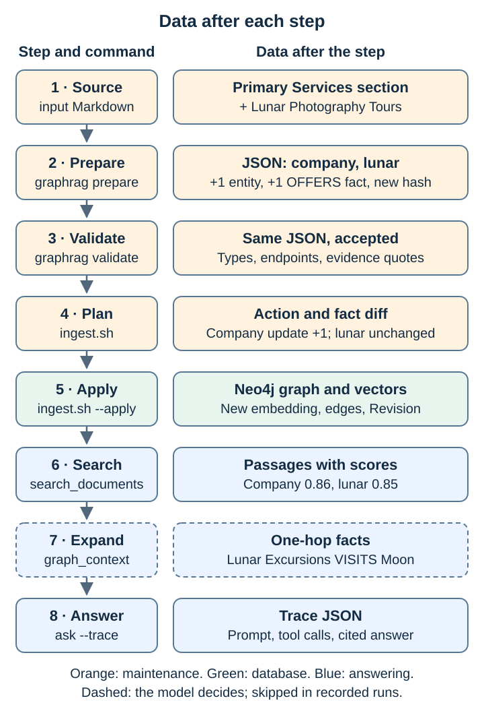

# Data lineage: what the data looks like after each step

One example, the [new-service update](../labs/03-add-fitting-data.md), followed from the source Markdown to the traced answer. Every excerpt below is real output from 13 November 2026 (long text shortened with `…`).



| Step | Command | Data after the step | Changes in the new-service scenario |
| --- | --- | --- | --- |
| 1 Source | — | Markdown section | One added service block |
| 2 Prepare | `graphrag prepare` | `company.json`, `lunar.json` | Company: +1 entity, +1 fact, new `source_version`. Lunar: identical |
| 3 Validate | `graphrag validate` | Same JSON, accepted or rejected | Nothing; the data passes v1 |
| 4 Plan | `ingest.sh` | Action plus fact diff per document | `company-overview: update`, +1 fact |
| 5 Apply | `ingest.sh --apply` | Neo4j nodes, edges, vector, `Revision` | Company edges replaced; lunar untouched |
| 6 Search | `search_documents` | Passages with scores | Company passage now lists the new service |
| 7 Expand | `graph_context` | One-hop facts with owning document | One more OFFERS fact. **The model may skip this step** |
| 8 Answer | `ask --trace` | Prompt version, tool calls, answer | Depends on steps 6–7 |

## 1. Source

[new-service/company-overview.md](../data/scenarios/new-service/company-overview.md) adds to *Primary Services*:

```diff
+- Lunar Photography Tours 4.
+- Guided lunar photography experience ◦
```

## 2. Prepare: Markdown → JSON

`prepare.py` maps the section into two documents. Only the company document changes (diff against [data/documents/company.json](../data/documents/company.json)):

```diff
-  "source_version": "0a8bbbbe…",
+  "source_version": "7c731687…",
   "text": "Galaxium Travels offers these primary services:\n- Orbital Flights\n- Lunar Excursions\n- Space Hotel Stays
+           \n- Lunar Photography Tours
            \n\nSource excerpt:\n- Orbital Flights 1.\n… Professional space photography ◦
+           \n\n- Lunar Photography Tours 4.\n- Guided lunar photography experience ◦",
   "entities": [ …,
+    {"id": "lunar-photography-tours", "name": "Lunar Photography Tours", "type": "Service"} ],
   "facts": [ …,
+    {"subject": "galaxium", "relation": "OFFERS", "object": "lunar-photography-tours"} ]
```

`source_version` is the SHA-256 of the mapped excerpt. `text` is what gets embedded; `entities` and `facts` become the graph.

## 3. Validate: accept or reject, no change

The validator checks entity types, relation endpoints, duplicate and conflicting IDs, the `source_version` format, and, when present, that each `evidence` quote backs a declared fact and appears in `text`. Output: `Validated 2 documents`. The training candidate stops here under v1: `ValueError: Unsupported ontology version`.

## 4. Plan: compare with the database

Each document's fingerprint (content + embedding model + dimensions) is compared with `Document.hash`, and its facts with the stored `RELATION` edges it owns:

```json
[
  {"id": "company-overview", "action": "update",
   "added_facts": ["galaxium OFFERS lunar-photography-tours"], "removed_facts": []},
  {"id": "lunar-itinerary", "action": "unchanged", "added_facts": [], "removed_facts": []}
]
```

Nothing is written.

## 5. Apply: write to Neo4j

For each changed document only, in one transaction after embedding:

| Before (baseline) | After |
| --- | --- |
| `company-overview` embedding of the 3-service text | New 768-dim embedding of the 4-service text |
| `MENTIONS` to galaxium + 3 services | `MENTIONS` to galaxium + 4 services |
| 3 `RELATION {kind:'OFFERS', document_id:'company-overview'}` | 4 such edges |
| `Revision` snapshots of earlier versions | + `Revision company-overview:<new hash>` with the JSON snapshot |
| `lunar-itinerary` and its `VISITS` edge | Unchanged, not rewritten |

A second `--apply` reports every document `unchanged` and writes nothing. Storage model: [graph versions](graphs/README.md#how-it-is-stored).

## 6. Search: question → passages

`search_documents` embeds the question and queries the vector index. Real result (baseline, `text` shortened):

```json
{"document_id": "company-overview", "source": "galaxium:company-overview#primary-services",
 "text": "Galaxium Travels offers these primary services:\n- Orbital Flights\n…", "score": 0.858}
{"document_id": "lunar-itinerary", "source": "galaxium:company-overview#lunar-excursions",
 "text": "Galaxium Travels Lunar Excursions:\n- Lunar Excursions 2.\n- 7-day lunar…", "score": 0.851}
```

## 7. Expand: document → one-hop facts

`graph_context("company-overview")` follows `MENTIONS` to entities, then one `RELATION` hop, including facts owned by other documents:

```json
{"subject": "Galaxium Travels", "relation": "OFFERS", "object": "Lunar Excursions", "document_id": "company-overview", "source": "galaxium:company-overview#primary-services"}
{"subject": "Lunar Excursions", "relation": "VISITS", "object": "Moon", "document_id": "lunar-itinerary", "source": "galaxium:company-overview#lunar-excursions"}
```

The second row is the cross-document hop. After the update, one more row appears: `Galaxium Travels OFFERS Lunar Photography Tours`.

## 8. Answer: what the model actually did

```json
{"model": "qwen3:8b", "prompt_version": "answering-v1",
 "tool_calls": [{"tool": "search_documents", "args": {"question": "destinations", "limit": 5}}],
 "answer": "Galaxium Travels customers can visit the **Moon** and **lunar orbit** … Source: [lunar-itinerary](galaxium:company-overview#lunar-excursions) …"}
```

The model skipped step 7 and answered from the passage text from step 6. Why, and what to try: [AI engineer guide](development.md#what-the-recorded-run-shows).
