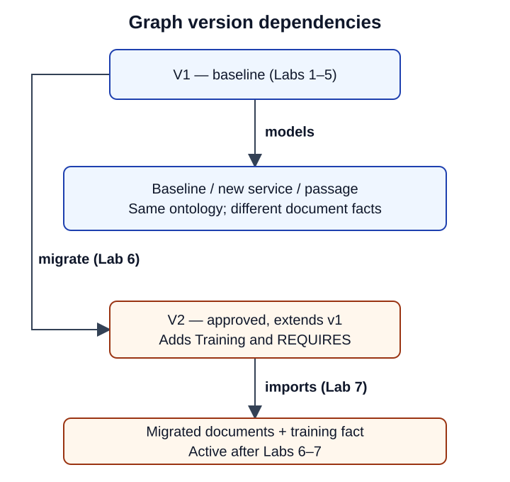
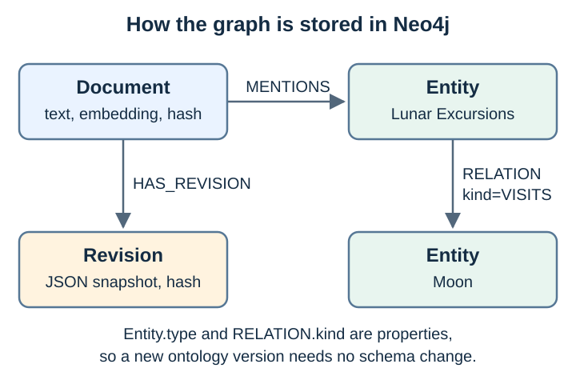
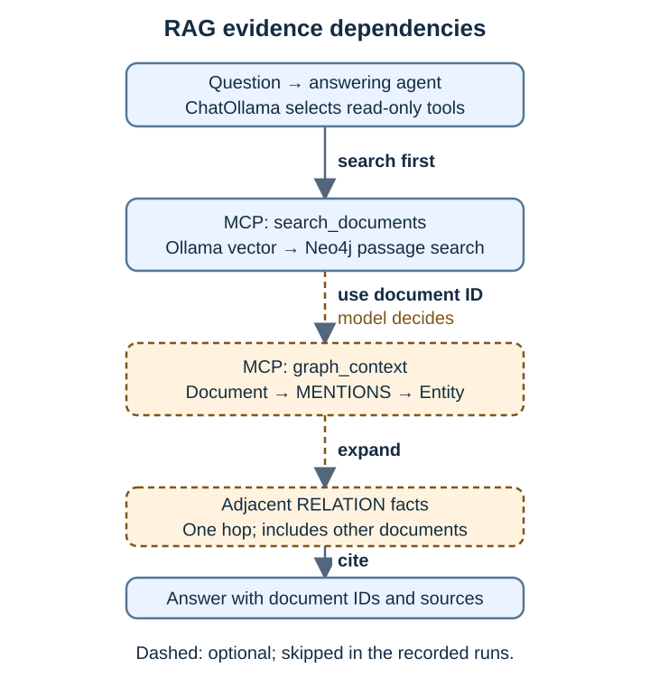

# Graph versions

| Version | Adds | Status | Page |
| --- | --- | --- | --- |
| v1 | Company, Service, Destination; OFFERS, VISITS | Baseline: active in a new graph (Labs 1–5) | [v1](v1.md) |
| v2 | Training; REQUIRES | Approved, extends v1: active after migration (Labs 6–12) | [v2](v2.md) |

Adding a service changes **data** under v1, not the ontology version. Replacing a document can remove its owned facts; deleting a document is not implemented. Each ontology is a JSON file in [data/ontologies](../../data/ontologies); a new graph starts on [v1.json](../../data/ontologies/v1.json). The graph records its active version as an `Ontology` node, and the importer validates against that version. `graphrag inspect` shows it; `graphrag migrate` changes it ([Lab 6](../../labs/06-migrate-graph-data.md)).

The ontology (what a dependency **means**) is not the same as the Neo4j data model (how it is **stored**). See [ontology vs data model](ontology-vs-data-model.md).

For the captured Neo4j views, read [initial graph and service update](initial-and-update.md):
what each color and relationship means, what changes, and why old revisions can
remain visible.

## How it is stored

| Node / edge | Holds |
| --- | --- |
| `Document` | Prepared passage: id, title, text, source citation, hash, embedding, ontology version |
| `Entity` | Stable id, name and `type` (Company, Service…) |
| `Document -MENTIONS-> Entity` | Starting points for graph expansion |
| `Entity -RELATION-> Entity` | Domain fact; `kind` is OFFERS/VISITS, plus owning `document_id`, source and revision |
| `Document -HAS_REVISION-> Revision` | Content-addressed JSON snapshot of each imported or migrated version |
| `Ontology -EXTENDS-> Ontology` | Graph definition versions; exactly one has `active: true` |

Types and relation kinds are properties, not Neo4j labels. The [architecture](../architecture.md#graph-storage-model) explains that choice. Source strings such as `galaxium:company-overview#primary-services` (company document) and `…#lunar-excursions` (lunar document) are logical citations, not URLs.

## How retrieval uses the graph

1. `search_documents` embeds the question with Ollama and queries the `document_embeddings` cosine index. Each document is embedded whole; there is no chunking.
2. `graph_context` starts from a retrieved document's mentioned entities and returns facts one hop away, including facts owned by **other** documents. That is how the company passage reaches the lunar fact.

The agent is *asked* to do both steps in order; the model decides (dashed in the diagram). `graphrag search` always does both. Real tool outputs: [data lineage](../data-lineage.md#6-search-question--passages).
