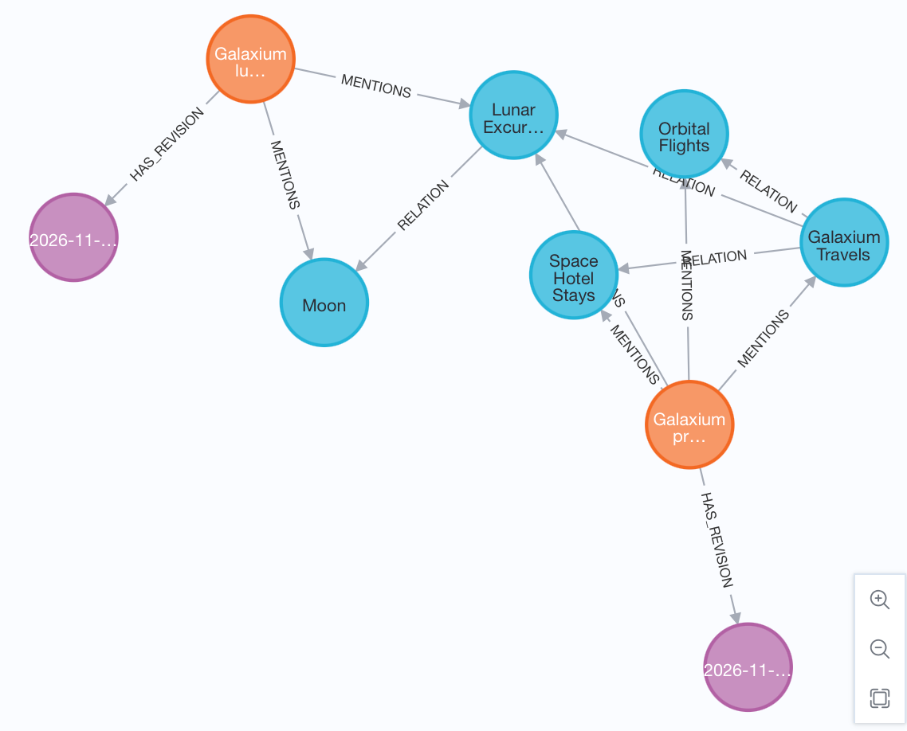
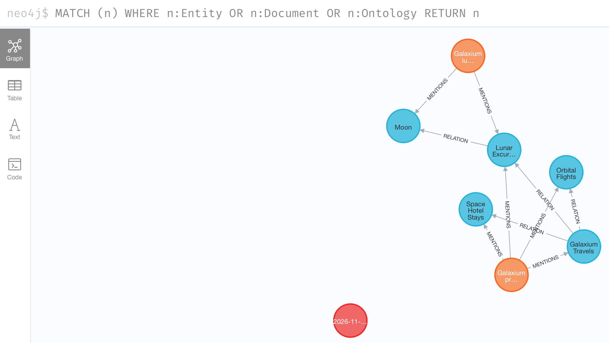
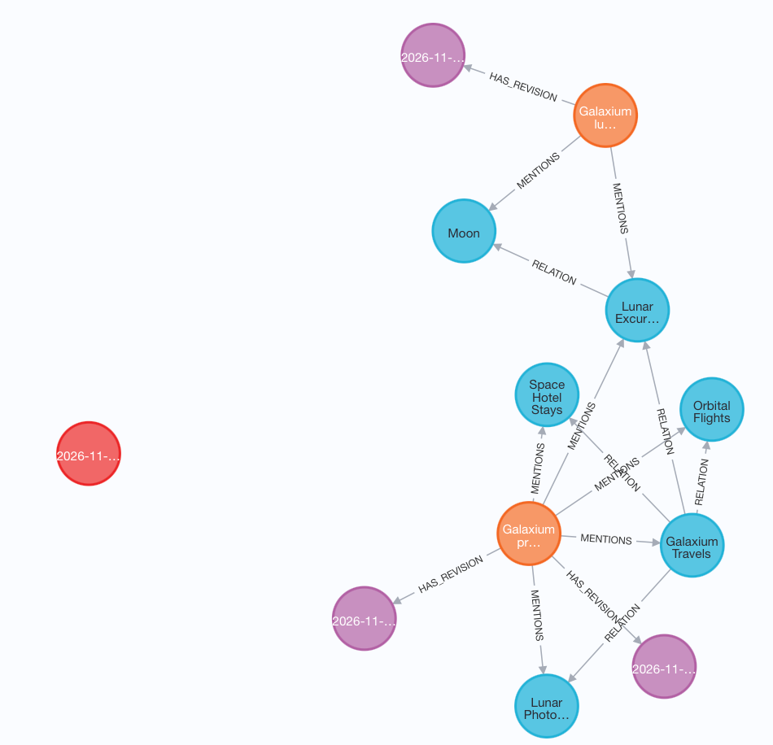
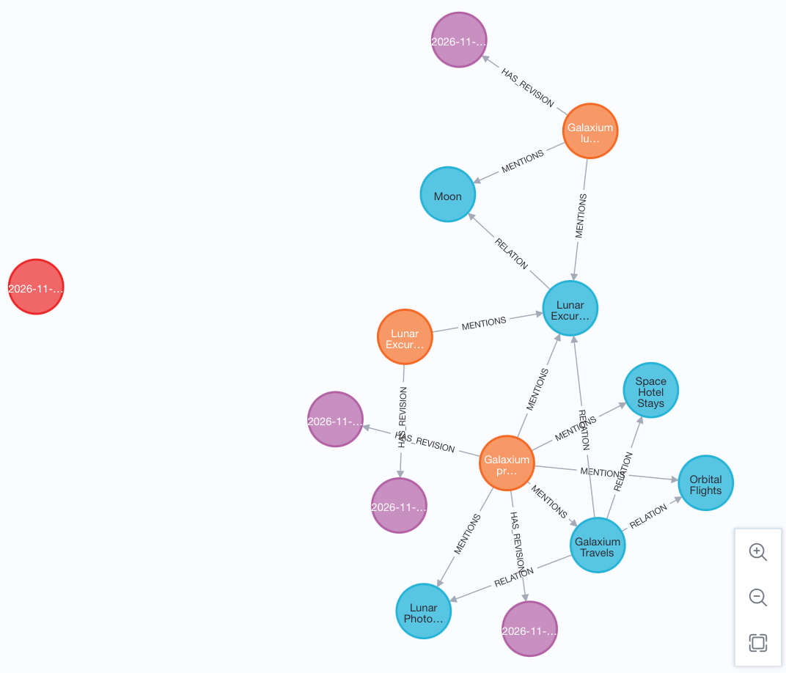
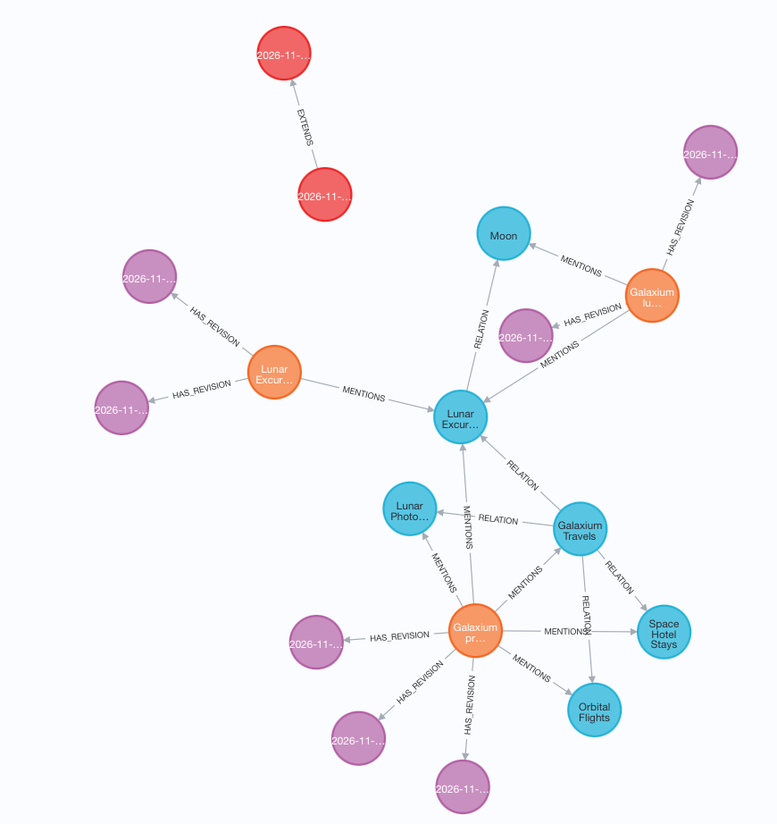
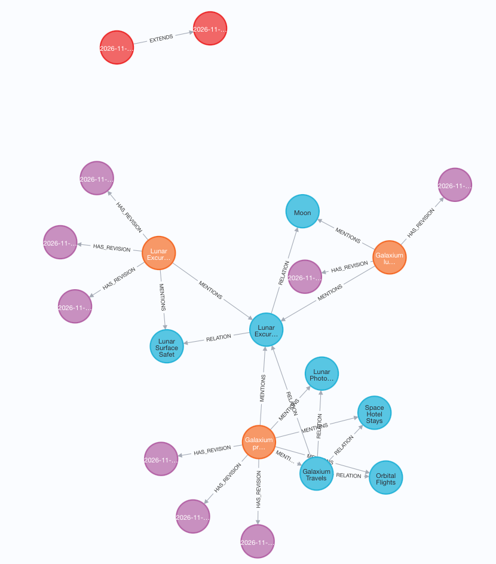

# Reading the graph: initial state and service update

The first two screenshots show the stored Neo4j graph right after
[Lab 1](../../labs/01-initial-setup.md), the first import into an empty
database. The third shows it after the
[new-service update](../../labs/03-add-fitting-data.md), and the fourth after
the passage-only [training policy](../../labs/04-add-non-fitting-data.md). These
four use **ontology v1**: the update adds Lunar Photography Tours as a Service,
and the training policy adds only a document. Neither introduces a new entity
type or activates v2. The fifth shows the graph after the
[migration to v2](../../labs/06-migrate-graph-data.md), and the sixth after the
[training dependency is imported as a fact](../../labs/07-add-new-data.md).

## How to read the screenshots

| Visible element | Meaning in these captures |
| --- | --- |
| Blue nodes | `Entity`: company, services and destination |
| Orange nodes | `Document`: the current company overview and lunar itinerary passages |
| Purple nodes | `Revision`: retained document snapshots; the date captions are truncated |
| Red node | `Ontology`: the recorded active ontology version; the date caption is truncated |
| `MENTIONS` arrows | A document refers to an entity; these links are the starting points for graph expansion |
| `RELATION` arrows | Domain facts between entities. Inspect the edge's `kind` property to distinguish OFFERS from VISITS |
| `HAS_REVISION` arrows | A document links to its retained content-addressed snapshots |

Colors and node positions are visualization settings, not ontology semantics.
The orange “Galaxium pr…” node represents `company-overview` (Galaxium Travels
primary services); “Galaxium lu…” represents `lunar-itinerary`. Select a node to
inspect its full ID/title/name. Overlapping lines and truncated labels make the
properties more reliable than the drawing for identifying individual facts.

## The baseline business graph

The first two captures contain the same business graph: five domain entities and two
documents.

- Galaxium Travels, its three baseline services (Orbital Flights, Lunar
  Excursions and Space Hotel Stays), and the Moon, connected by the
  [four baseline facts](../../labs/01-initial-setup.md#step-3-inspect-the-graph-state).
- The company document mentions the company and its three services. The lunar
  document mentions Lunar Excursions and the Moon. The shared Lunar Excursions
  entity connects the two evidence documents for retrieval.

The two captures differ only in which supporting nodes they include.

## 1. With document revisions — `01-graph.png`



Each document has exactly one `HAS_REVISION` link to a purple `Revision` node,
because each document has been imported once. The `Ontology` node is not part of
this capture.

## 2. With the ontology node — `02-graph.png`



This is the result of the query from
[Lab 1, Step 4](../../labs/01-initial-setup.md#step-4-optional-look-at-it):

```cypher
MATCH (n) WHERE n:Entity OR n:Document OR n:Ontology RETURN n
```

The query does not match `Revision`, so no purple nodes appear. The red
`Ontology` node (version 1) has no relationships. It records which ontology
version the importer validates against; it is not connected to individual
documents or entities.

## 3. After the service update — `03-graph.png`



This capture, taken after [Lab 3](../../labs/03-add-fitting-data.md), shows
all node types: entities, documents, revisions and the ontology.

- A new blue entity, Lunar Photography Tours (“Lunar Photo…”), at the bottom.
- The company document **MENTIONS** Lunar Photography Tours.
- Galaxium Travels has a **RELATION** to Lunar Photography Tours whose `kind`
  is **OFFERS**.
- The three original service offers and Lunar Excursions → VISITS → Moon remain.
- The company document now has two `HAS_REVISION` links: the original snapshot
  is kept and the new one is added. The lunar document still has one.
- The `Ontology` node is unchanged and still isolated: the update is data, not a
  model change.

## 4. A passage that does not fit as facts — `04-graph.png`



This capture, taken after importing the passage-only training policy in
[Lab 4, Step 3](../../labs/04-add-non-fitting-data.md#step-3-the-passage-only-version-c-fits),
shows all node types again.

- A third orange document, `lunar-training-policy` (“Lunar Excur…”), with one
  `HAS_REVISION` link.
- Its only connection to the business graph is **MENTIONS** → Lunar Excursions.
- There is **no** `Training` entity and **no** new `RELATION`. The sentence
  “Lunar Excursions requires completion of Lunar Surface Safety training” exists
  only in the passage text.
- Everything from Lab 3 is unchanged: five facts, two company revisions, one
  lunar revision and the same `Ontology` node.

The orange “Lunar Excur…” document and the blue “Lunar Excur…” entity look alike
because the labels are truncated. Check the node label (`Document` or `Entity`)
by selecting it.

## 5. After the migration to v2 — `05-graph.png`



This capture, taken after `graphrag migrate --apply` in
[Lab 6](../../labs/06-migrate-graph-data.md), shows all node types. Lab 5 itself
does not change the graph: a capture taken during Lab 5 would look like
`04-graph.png`.

- Two red `Ontology` nodes. Version 2 is active and has an **EXTENDS** link to
  version 1, which is now inactive.
- Each document has one more `HAS_REVISION` link: three for the company document,
  two for the lunar itinerary and two for the training policy. The migration
  stores each relabelled document as a new revision and keeps the old one.
- Entities, `MENTIONS` and `RELATION` edges are the same as in `04-graph.png`.
  Facts and embeddings are untouched.
- There is still no `Training` entity. v2 allows the type, but no document has
  added one yet.

From this point on, the importer validates against ontology 2.

## 6. The dependency as a fact — `06-graph.png`



This capture, taken after importing the modelled training policy in
[Lab 7](../../labs/07-add-new-data.md), shows all node types.

- A new blue entity, Lunar Surface Safety (“Lunar Surface Safet…”), of type
  `Training`.
- Lunar Excursions has a **RELATION** to it whose `kind` is **REQUIRES**: the
  sentence that existed only as text in `04-graph.png` is now a traversable edge.
- The training policy document **MENTIONS** both Lunar Excursions and Lunar
  Surface Safety, and has a third `HAS_REVISION` link.
- The company and lunar documents, their revisions and the two `Ontology` nodes
  are the same as in `05-graph.png`.

Compare it with `04-graph.png`: the document and its text are the same, but the
graph can now answer *“Which services require any training?”* by following an
edge instead of relying on vector search.

## Changes from the baseline to the service update

| Item | Baseline (Lab 1) | After the service update |
| --- | --- | --- |
| Current service offers | Three | Four, including Lunar Photography Tours |
| Expected active domain facts | Four | Five |
| Active documents | Company overview and lunar itinerary | Same two document IDs |
| Lunar evidence | Lunar Excursions visits Moon | Preserved |
| Ontology | V1 | V1 |
| Revisions | One per document | Two for the company document, one for the lunar document |

The company document's current passage includes the new service and receives an
updated embedding. The lunar document's passage and facts are unchanged. The
graph layout moves nodes between captures; movement does not indicate a
semantic change.

An update creates a revision only when that document/configuration fingerprint
has not been stored before. Reapplying previously imported content reuses its
existing snapshot. Inspect `Document.hash` and the revision's `hash` to identify
the active snapshot; `HAS_REVISION` by itself does not mean “currently active.”

RAG searches current document passages and expands their active facts. It does
not retrieve old `Revision.snapshot` content automatically. Entity nodes whose
connections were removed by a later document replacement stay in the graph but
supply no current evidence. After the update, the active company passage and
OFFERS fact can support an answer that Galaxium Travels offers Lunar Photography
Tours.

## Verify the properties behind the drawing

Run the three read-only queries in the [runtime reference](../reference.md#inspecting-the-graph).
Expected results:

| Query | Baseline | After the service update |
| --- | --- | --- |
| Active facts | The four baseline rows | One more: Galaxium Travels / OFFERS / Lunar Photography Tours |
| Mentions | `company-overview` → galaxium + 3 services; `lunar-itinerary` → `lunar-excursions`, `moon` | `company-overview` also mentions `lunar-photography-tours` |
| Revisions | Exactly one `true` per document | Exactly one `true` per document, now the new company snapshot |

See [v1 contents](v1.md) for the fixture inventory and the
[storage and retrieval guide](README.md) for the node/edge model.
