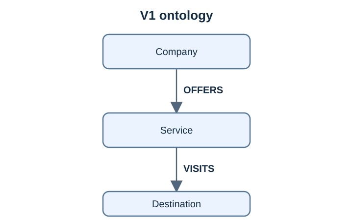

# Graph v1: company, services, destinations

[← All versions](README.md) · Status: **baseline**, active until the Lab 6 migration to v2.

V1 answers which services Galaxium Travels offers and where a service goes. The shared `lunar-excursions` entity links company evidence to itinerary evidence.

| Relation | Subject → object | Meaning |
| --- | --- | --- |
| OFFERS | Company → Service | The company offers the service |
| VISITS | Service → Destination | The service visits the destination |

No other combinations are valid. A Service does not need a destination: none is invented for Orbital Flights or Space Hotel Stays. Specification: [v1.json](../../data/ontologies/v1.json).

## What is in the RAG

`graphrag prepare` maps the *Primary Services* section of the [company overview](../../data/input-documents/galaxium-travels-company_overview.md) into two documents:

| Document | Text | Facts it owns |
| --- | --- | --- |
| `company-overview` ([company.json](../../data/documents/company.json)) | Service list and the full Primary Services excerpt | Galaxium OFFERS Orbital Flights, Lunar Excursions, Space Hotel Stays |
| `lunar-itinerary` ([lunar.json](../../data/documents/lunar.json)) | Lunar Excursions block ("Moon surface exploration") | Lunar Excursions VISITS Moon |

`source_version` is a SHA-256 of each mapped excerpt. Each document has its own `source` anchor: `#primary-services` for the company document, `#lunar-excursions` for the lunar one. Not indexed: the rest of the Markdown, Future Plans (Mars), finances and leadership. Some details stay in the passage text without becoming typed facts.

## Add an instance without changing the ontology

[Lab 3](../../labs/03-add-fitting-data.md) adds Lunar Photography Tours as a fourth `Service` with one new `OFFERS` fact. Its name is new; its type and relation already exist in v1.
