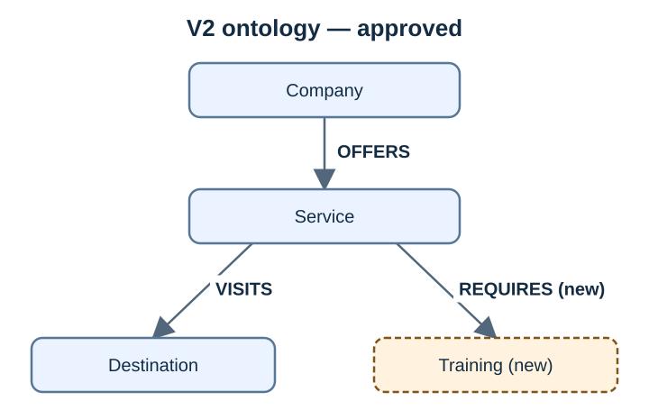

# Graph v2: training requirements

[← All versions](README.md) · Status: **approved**, `extends: "1"`. Active in a graph after [Lab 6](../../labs/06-migrate-graph-data.md).

V2 answers which training a service requires. The motivating source sentence: *Lunar Excursions requires completion of Lunar Surface Safety training before departure.*

| Element | Change |
| --- | --- |
| Company, Service, Destination; OFFERS, VISITS | Unchanged from v1 |
| `Training` | New entity type |
| Service → `REQUIRES` → Training | New relation |

The change is purely additive ([v2.json](../../data/ontologies/v2.json); compare with `graphrag ontology-diff`, [Lab 5](../../labs/05-update-graph-definition.md)). "Before departure", completion status and enforcement are not modelled.

## How a graph gets to v2

| Step | Lab | Result |
| --- | --- | --- |
| Compare v1 and v2 | [5](../../labs/05-update-graph-definition.md) | `compatible: true`; graph still on v1 |
| Migrate stored documents | [6](../../labs/06-migrate-graph-data.md) | Every document relabelled and revalidated; facts and embeddings unchanged |
| Add the training fact | [7](../../labs/07-add-new-data.md) | `lunar-excursions REQUIRES lunar-surface-safety` |

After Lab 7, the shared `lunar-excursions` ID lets graph expansion reach the training fact from every document that mentions Lunar Excursions ([Lab 8](../../labs/08-all-questions.md)).
