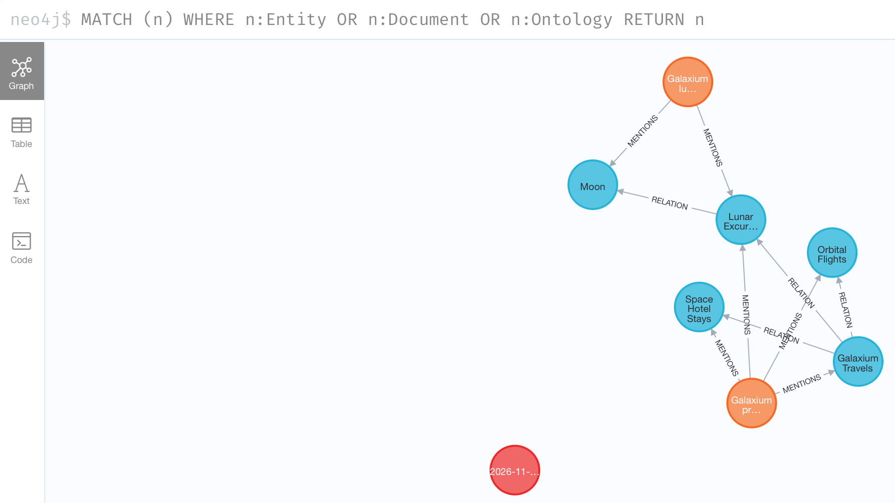

# Lab 1: Initial setup

[← Labs](README.md) · Next: [Lab 2](02-initial-question.md)

**Goal:** a fresh demo database containing the baseline graph under ontology v1.

| | Before | After |
| --- | --- | --- |
| Ontology | — (empty database) | **1** |
| Documents | — | `company-overview@67b0010436b7`, `lunar-itinerary@4b9e5f32b2f7` |
| Facts | 0 | 4 |

## Prerequisites

Install Python 3.11+, Ollama and Rancher Desktop (dockerd/Moby engine). Put `docker` (Compose v2), `ollama`, `curl` and `lsof` on PATH. Run every command in every lab from the repository root.

## Step 1: Start from an empty demo database

```bash
./scripts/stop.sh --delete-data   # skip on the very first run: nothing to delete yet
./scripts/start.sh
```

The first start creates `.env` and `.venv`, installs locked packages, pulls `qwen3:8b` and `nomic-embed-text` (several GB), starts Neo4j, imports the baseline and starts the MCP server. On macOS it opens Rancher Desktop if needed. Later starts take seconds. Settings are in the [runtime reference](../docs/reference.md).

**Expected result:** `stop.sh` prints `Stopped and deleted the demo Neo4j volume.` `start.sh` imports `data/documents` and shows both documents as `"action": "create"`. It ends with:

```sh
{ "neo4j": "reachable",
  "models": [… "nomic-embed-text:latest", "qwen3:8b"],
  "mcp_tools": ["search_documents", "graph_context"]
}
[graphrag] Ready. Neo4j: http://localhost:7474 | MCP: http://127.0.0.1:8000/mcp
```

## Step 2: Prove the baseline comes from the source document

```bash
.venv/bin/graphrag prepare --output .runtime/lab-01
diff -r .runtime/lab-01 data/documents
.venv/bin/graphrag validate
```

**Expected result:**

```text
Prepared 2 documents in .runtime/lab-01; graph unchanged
Validated 2 documents
```

`diff` prints nothing. The checked-in JSON is exactly what the reviewed mapping produces from [the company overview](../data/input-documents/galaxium-travels-company_overview.md). This is insertion rule 1 (mapping): only the *Primary Services* section is mapped.

## Step 3: Inspect the graph state

```bash
.venv/bin/graphrag inspect
```

**Expected result:**

```json
{
  "ontology": "1",
  "ontology_history": [{ "version": "1", "active": true, "activated_at": "…" }],
  "documents": [
    { "id": "company-overview", "ontology_version": "1", "revision": "67b0010436b7", "revisions": 1 },
    { "id": "lunar-itinerary",  "ontology_version": "1", "revision": "4b9e5f32b2f7", "revisions": 1 }
  ],
  "facts": [
    "galaxium OFFERS lunar-excursions  [company-overview]",
    "galaxium OFFERS orbital-flights  [company-overview]",
    "galaxium OFFERS space-hotel-stays  [company-overview]",
    "lunar-excursions VISITS moon  [lunar-itinerary]"
  ],
  "entity_types": { "Company": 1, "Destination": 1, "Service": 3 }
}
```

The first import recorded the active graph definition as an `Ontology` node with version 1. From now on, every import is validated against **that** recorded version.

## Step 4 (optional): Look at it

Open http://localhost:7474 (user `neo4j`, password from `.env`) and run:

```cypher
MATCH (n) WHERE n:Entity OR n:Document OR n:Ontology RETURN n
```

**Expected result:** two orange documents, five blue entities and one isolated `Ontology` node. Galaxium Travels has a `RELATION` to each of its three services, and Lunar Excursions has one to the Moon.



[Initial graph and service update](../docs/graphs/initial-and-update.md) explains the colours and edges.

## Commands you will use in every lab

| Command | Purpose |
| --- | --- |
| `.venv/bin/graphrag inspect` | Graph state: ontology, document revisions, facts |
| `.venv/bin/graphrag search "…"` | Retrieval only, no LLM |
| `.venv/bin/graphrag ask --trace "…"` | Agent answer plus tool calls and prompt version |
| `./scripts/ingest.sh --data DIR [--apply]` | Plan, then write documents |
| `./scripts/status.sh` | Service health |
| `./scripts/stop.sh` | Stop services, keep data |

## Check yourself

- [ ] `inspect` shows ontology `1`, 2 documents, 4 facts.
- [ ] Your revision IDs match `67b0010436b7` and `4b9e5f32b2f7`. If they differ, check `OLLAMA_EMBED_MODEL` and `EMBEDDING_DIMENSIONS` in `.env`: they are part of the revision.
