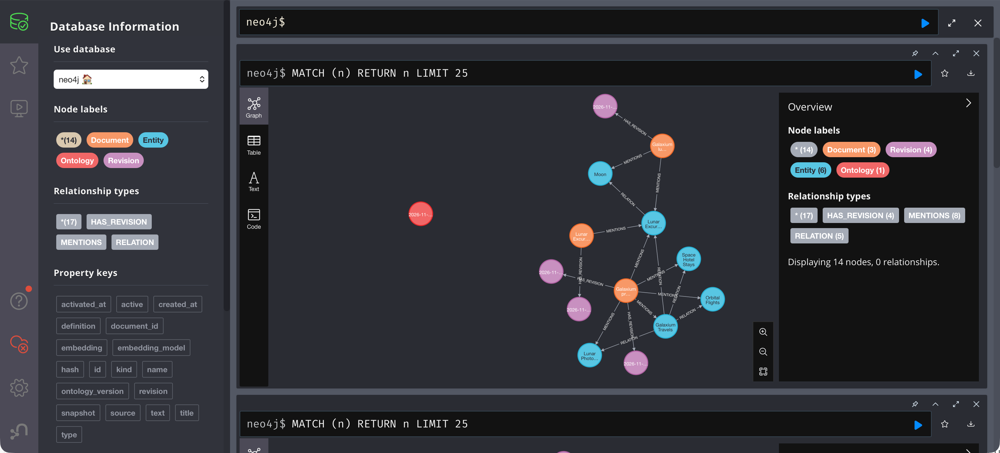

# Lab 3: Add data that fits the data format

[← Lab 2](02-initial-question.md) · [Labs](README.md) · Next: [Lab 4](04-add-non-fitting-data.md)

**Goal:** add a new service. It is a new **instance** of an existing type, so the graph definition does not change.

| | Before | After |
| --- | --- | --- |
| Ontology | 1 | 1 |
| Source | [original overview](../data/input-documents/galaxium-travels-company_overview.md) | [new-service overview](../data/scenarios/new-service/company-overview.md) |
| company-overview | `67b0010436b7` (1 revision) | `dda631181ef7` (2 revisions) |
| Facts | 4 | 5 |

The new source adds one block:

```diff
+- Lunar Photography Tours 4.
+- Guided lunar photography experience ◦
```

## Step 1: Prepare and validate

```bash
.venv/bin/graphrag prepare --source data/scenarios/new-service/company-overview.md --output .runtime/lab-03
.venv/bin/graphrag validate --data .runtime/lab-03
```

**Expected result:**

```text
Prepared 2 documents in .runtime/lab-03; graph unchanged
Validated 2 documents
```

## Step 2: Plan, then apply

```bash
./scripts/ingest.sh --data .runtime/lab-03            # plan only
```

**Expected result:**

```json
[
  {
    "id": "company-overview",
    "action": "update",
    "added_facts": [
      "galaxium OFFERS lunar-photography-tours"
    ],
    "removed_facts": []
  },
  {
    "id": "lunar-itinerary",
    "action": "unchanged",
    "added_facts": [],
    "removed_facts": []
  }
]
```

Review the plan: exactly one added fact and nothing removed. Then write:

```bash
./scripts/ingest.sh --data .runtime/lab-03 --apply
./scripts/ingest.sh --data .runtime/lab-03            # repeat the plan
```

**Expected result:** the repeated plan shows `"action": "unchanged"` for both documents. Imports are idempotent.

## Step 3: Inspect

```bash
.venv/bin/graphrag inspect
```

**Expected result:** ontology `1`; `company-overview` at revision `dda631181ef7` with `"revisions": 2`; `lunar-itinerary` unchanged at `4b9e5f32b2f7`. Five facts, with the new one:

```text
galaxium OFFERS lunar-photography-tours  [company-overview]
```

`entity_types` is `{"Company": 1, "Destination": 1, "Service": 4}`.

Optionally, look at it in Neo4j Browser (http://localhost:7474). The company document now has two purple revisions, the lunar document still has one, and Lunar Photography Tours is connected by `MENTIONS` from the company document and by `RELATION` (OFFERS) from Galaxium Travels:



[Initial graph and service update](../docs/graphs/initial-and-update.md#changes-through-the-labs) explains what changed.

## Step 4: Ask the initial question (Q1) again

```bash
.venv/bin/graphrag ask --trace "Which destination can Galaxium Travels customers visit? Cite your sources."
```

**Expected result:** still **the Moon**. The new service has no `VISITS` fact, so the answer must not change. Recorded run: Moon plus "lunar orbit", citing `company-overview` and `lunar-itinerary`, `search_documents` only.

## Step 5: Ask the new question (Q2)

```bash
.venv/bin/graphrag search "Which services does Galaxium Travels offer?"
.venv/bin/graphrag ask --trace "Which services does Galaxium Travels offer? Cite your sources."
```

**Expected result:** `search` returns `company-overview` (0.894) with **four** `OFFERS` facts, including `Galaxium Travels OFFERS Lunar Photography Tours`. The recorded answer lists Orbital Flights, Lunar Excursions, Space Hotel Stays and **Lunar Photography Tours**, citing `galaxium:company-overview#primary-services`.

## Why it fit

The new block produced only things v1 already knows. Gate by gate:

| Gate | Check | Result |
| --- | --- | --- |
| Mapping | `Lunar Photography Tours` is in the reviewed `SERVICES` list | Pass |
| Document format | Same fields as before | Pass |
| Ontology v1 | Entity type `Service`; fact `Company OFFERS Service` | Pass |
| Plan | +1 fact, −0 facts | Reviewed |

A new **name** is data. A new **kind of thing** or **kind of relationship** is a model change (Lab 4).

## Check yourself

- [ ] 5 facts, ontology still `1`.
- [ ] `company-overview` has 2 revisions: the old snapshot is kept.

<details>
<summary><b>Show answers</b></summary>

1. The new Service instance adds one OFFERS fact, giving five facts under ontology 1.
2. Only company-overview gains a revision; the old snapshot remains and lunar-itinerary is unchanged.

</details>
