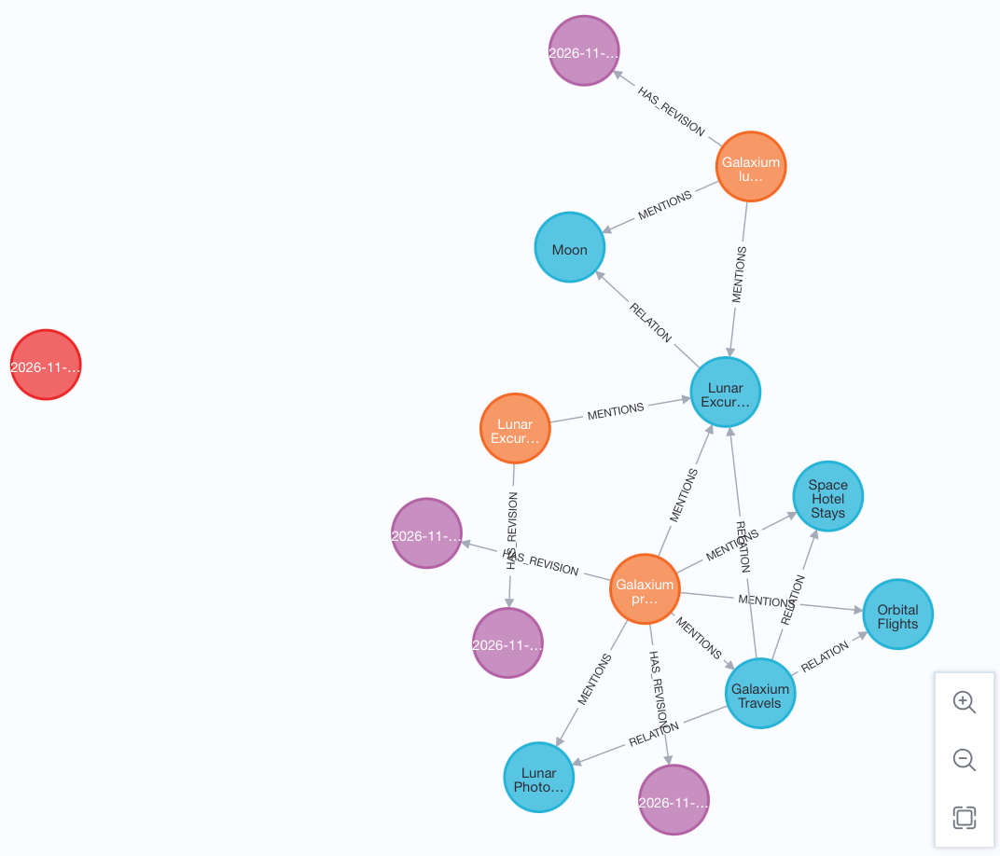

# Lab 4: Add data that does not fit the data format

[← Lab 3](03-add-fitting-data.md) · [Labs](README.md) · Next: [Lab 5](05-update-graph-definition.md)

**Goal:** see the insertion rules reject data, and understand why one version of the same information still *fits*.

| | Before | After |
| --- | --- | --- |
| Ontology | 1 | 1 |
| Documents | 2 | 3 (+ `lunar-training-policy@c605d673f7f5`) |
| Facts | 5 | **5** (no new fact) |

The new source is the [training policy](../data/scenarios/training-requirement/lunar-training-policy.md):

> Lunar Excursions requires completion of Lunar Surface Safety training before departure.

It contains a **dependency**: a service *requires* a training. v1 has no `Training` type and no `REQUIRES` relation.

You try three versions of this document:

| Variant | File | Contains |
| --- | --- | --- |
| A. Modelled | [candidates/training.json](../data/scenarios/training-requirement/candidates/training.json) | `Training` entity, `REQUIRES` fact, evidence, labelled v2 |
| B. Unstructured | [unstructured/training.json](../data/scenarios/training-requirement/unstructured/training.json) | v1 label, plus a free-form `"policy": {…}` JSON object |
| C. Passage only | [v1-passage/training.json](../data/scenarios/training-requirement/v1-passage/training.json) | v1 label, only the `Service` entity, **no facts** |

## Step 1: The modelled dependency (A) is rejected

```bash
./scripts/ingest.sh --data data/scenarios/training-requirement/candidates
```

**Expected result:** exit code 1 and:

```text
Rejected under active ontology 1: data/scenarios/training-requirement/candidates/training.json: Unsupported ontology version: document declares '2', ontology is '1'
```

Changing the label to `"1"` does not help. Then the error is `Unknown entity type: Training`. Relabelling Training as Service would pass, but it would be a false statement in the graph. Do not do that.

## Step 2: Unstructured JSON (B) is rejected

Someone tries to "just store the JSON" and puts the dependency in an extra object:

```json
"policy": { "service": "Lunar Excursions", "requires": "Lunar Surface Safety", "when": "before departure" }
```

```bash
./scripts/ingest.sh --data data/scenarios/training-requirement/unstructured
```

**Expected result:** exit code 1 and:

```text
Rejected under active ontology 1: data/scenarios/training-requirement/unstructured/training.json: Document has fields outside the document format: ['policy']
```

The fixed document format rejects unknown fields at every level:

| Attempt | Error |
| --- | --- |
| Extra top-level field (`"policy"`, `"payload"`, …) | `Document has fields outside the document format` |
| Extra entity or fact property (`"requires"`, `"since"`, …) | `Entity has fields outside …` / `Fact has fields outside …` |
| JSON pasted into `text` | `text must be a prose passage, not embedded JSON` |
| ID with spaces or capitals | `must be a lowercase slug` |

## Step 3: The passage-only version (C) fits

```bash
.venv/bin/graphrag validate --data data/scenarios/training-requirement/v1-passage
./scripts/ingest.sh --data data/scenarios/training-requirement/v1-passage
```

**Expected result:**

```text
Validated 1 documents
```

```json
[{ "id": "lunar-training-policy", "action": "create", "added_facts": [], "removed_facts": [] }]
```

The plan creates a document **with zero facts**. Apply it:

```bash
./scripts/ingest.sh --data data/scenarios/training-requirement/v1-passage --apply
.venv/bin/graphrag inspect
```

**Expected result:** ontology `1`; three documents (`lunar-training-policy` at `c605d673f7f5`); still **5** facts; `entity_types` unchanged, with no `Training`.

In Neo4j Browser the new document (orange “Lunar Excur…”) has one revision and a single `MENTIONS` link to Lunar Excursions. There is no `Training` node and no new `RELATION`: the dependency is not in the graph.



## Step 4: Ask Q3 against the passage

```bash
.venv/bin/graphrag search "Which training does a Lunar Excursions customer need before departure?"
.venv/bin/graphrag ask --trace "Which training does a Lunar Excursions customer need before departure? Cite your sources."
```

**Expected result:** `search` ranks `lunar-training-policy` first (0.928), but its graph facts are only:

```text
lunar-training-policy 0.928
    Galaxium Travels OFFERS Lunar Excursions [company-overview]
    Lunar Excursions VISITS Moon [lunar-itinerary]
```

There is no `REQUIRES` fact. The recorded answer is still correct (*Lunar Surface Safety training*, citing `lunar-training-policy`), because the model **read it from the text**.

## Why did C fit?

Validation checks **structure, not meaning**. Variant C declares only things v1 knows: one `Service` entity and no facts. Every gate passes. The dependency is still in the document, but only as prose:

| | In the text | In the graph |
| --- | --- | --- |
| Lunar Excursions requires Lunar Surface Safety | Yes | **No** |

The consequences:

- Vector search finds the sentence when the question is close to it (Q3 works by luck of wording).
- The graph cannot traverse the dependency. *"Which services require any training?"* or *"What must I complete before visiting the Moon?"* have no edge to follow.
- Nothing warns you. Knowledge is silently lost from the graph.

That is why the dependency needs a graph definition change, not a workaround. Lab 5 makes it.

## Check yourself

- [ ] A and B were rejected without a Python traceback.
- [ ] C was imported; facts are still 5 and no `Training` type exists.
- [ ] You can explain why C passed every gate.

<details>
<summary><b>Show answers</b></summary>

1. A declares v2; B has the unsupported policy field. Both are rejected before import.
2. C adds a searchable passage with zero facts, so the graph still has five facts and no Training entity.
3. The validator checks declared structure. It does not extract the dependency from prose or detect its omission.

</details>
