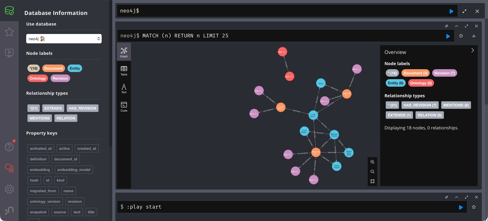

# Lab 6: Migrate the existing graph data

[← Lab 5](05-update-graph-definition.md) · [Labs](README.md) · Next: [Lab 7](07-add-new-data.md)

**Goal:** move every stored document from v1 to v2 and switch the graph's active definition, in one transaction.

| | Before | After |
| --- | --- | --- |
| Active ontology | 1 | **2** |
| company-overview | `dda631181ef7` (2 revisions) | `9ede1e012ffb` (3) |
| lunar-itinerary | `4b9e5f32b2f7` (1) | `2e78a4da7fa0` (2) |
| lunar-training-policy | `c605d673f7f5` (1) | `506be0ab4d67` (2) |
| Facts | 5 | 5 (unchanged) |

## What the migration does

For each document, the migration takes the **current revision snapshot** from the graph, not the files on disk. Then it:

1. Sets `ontology_version` to `"2"`.
2. Revalidates the document under v2 (all insertion rules apply again).
3. Stores the result as a new `Revision` with `migrated_from` pointing at the old revision hash.
4. Updates the document's revision and its facts' `revision`.

Finally it marks `Ontology 1` inactive, activates `Ontology 2`, and links `(2)-[:EXTENDS]->(1)`. Facts and embeddings stay untouched. The text did not change, so nothing is re-embedded.

It refuses unless the target is `approved`, `extends` the active version, and is additive.

## Step 1: Plan

```bash
.venv/bin/graphrag migrate --ontology data/ontologies/v2.json
```

**Expected result** (`diff` is the same as in Lab 5 and is shortened here):

```json
{
  "from": "1",
  "to": "2",
  "diff": { "added_types": ["Training"], "added_relations": { "REQUIRES": ["Service", "Training"] }, "compatible": true, … },
  "documents": [
    { "id": "company-overview",      "revision_before": "dda631181ef7", "revision_after": "9ede1e012ffb" },
    { "id": "lunar-itinerary",       "revision_before": "4b9e5f32b2f7", "revision_after": "2e78a4da7fa0" },
    { "id": "lunar-training-policy", "revision_before": "c605d673f7f5", "revision_after": "506be0ab4d67" }
  ],
  "facts_before": 5,
  "facts_after": 5,
  "embeddings": "reused: text is unchanged"
}
```

Note that all three documents migrate, including the passage-only document from Lab 4 and the Lab 3 update. The migration covers the graph's state, not a folder of files.

## Step 2: Apply

```bash
.venv/bin/graphrag migrate --ontology data/ontologies/v2.json --apply
```

**Expected result:** the same JSON as the plan, plus `"applied": true`.

## Step 3: Verify

```bash
.venv/bin/graphrag inspect
```

**Expected result:**

```json
{
  "ontology": "2",
  "ontology_history": [
    { "version": "1", "active": false, "activated_at": "…" },
    { "version": "2", "active": true,  "activated_at": "…" }
  ],
  "documents": [
    { "id": "company-overview",      "ontology_version": "2", "revision": "9ede1e012ffb", "revisions": 3 },
    { "id": "lunar-itinerary",       "ontology_version": "2", "revision": "2e78a4da7fa0", "revisions": 2 },
    { "id": "lunar-training-policy", "ontology_version": "2", "revision": "506be0ab4d67", "revisions": 2 }
  ],
  "facts": [ … the same 5 facts as before … ],
  "entity_types": { "Company": 1, "Destination": 1, "Service": 4 }
}
```

In Neo4j Browser, the migration is visible only in the supporting nodes:

- Two red `Ontology` nodes, linked by `EXTENDS` from version 2 to version 1.
- One more purple revision per document: three for the company document, two each for the lunar itinerary and the training policy.
- The business graph is unchanged. There are still five facts, and there is no `Training` entity yet, because v2 only *allows* it. Lab 7 adds the data.



Retrieval is unaffected:

```bash
.venv/bin/graphrag search "Which destination can Galaxium Travels customers visit?"
```

**Expected result:** `company-overview` 0.859, `lunar-itinerary` 0.851, `lunar-training-policy` 0.749, the same scores as before the migration.

## Step 4: The rules now follow v2

```bash
.venv/bin/graphrag migrate --ontology data/ontologies/v2.json   # again
./scripts/ingest.sh --data data/documents                       # old v1 files
```

**Expected result:**

```text
Migration refused: Graph is already on ontology 2
Rejected under active ontology 2: data/documents/company.json: Unsupported ontology version: document declares '1', ontology is '2'
```

The checked-in v1 files can no longer be imported, by design. New imports must be prepared for v2: `graphrag prepare --ontology data/ontologies/v2.json …` (Lab 7). `./scripts/start.sh` detects this and skips its baseline import instead of failing.

## Check yourself

- [ ] `inspect` shows ontology `2` and the history `1 → 2`.
- [ ] Fact count and search scores are unchanged.
- [ ] In Neo4j Browser, `MATCH (o:Ontology) RETURN o` shows two nodes linked by `EXTENDS`.

<details>
<summary><b>Show answers</b></summary>

1. Ontology 2 becomes active; ontology 1 remains in history.
2. The five facts and passage text stay the same. Embeddings are reused; relabelled documents get new revisions.
3. EXTENDS points from version 2 to version 1.

</details>

Rollback: the old snapshots are kept as `Revision` nodes, but there is no down-migration command. To go back, reset (see [Labs](README.md#reset)) and repeat Labs 1–5.
