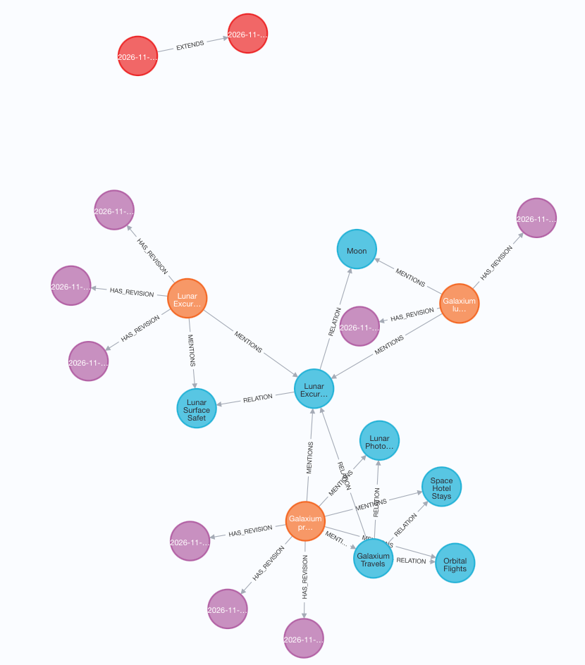

# Lab 7: Add the new data

[← Lab 6](06-migrate-graph-data.md) · [Labs](README.md) · Next: [Lab 8](08-all-questions.md)

**Goal:** import the training dependency as a real graph fact, now that the graph is on v2.

| | Before | After |
| --- | --- | --- |
| Active ontology | 2 | 2 |
| lunar-training-policy | `506be0ab4d67` (2 revisions, 0 facts) | `ee18024d91ef` (3 revisions, 1 fact) |
| Facts | 5 | **6** |
| Entity types | Company, Destination, Service | + **Training** |

## Step 1: Plan the modelled document (variant A from Lab 4)

```bash
./scripts/ingest.sh --data data/scenarios/training-requirement/candidates
```

**Expected result:**

```json
[
  { "id": "lunar-training-policy", "action": "update",
    "added_facts": ["lunar-excursions REQUIRES lunar-surface-safety"], "removed_facts": [] }
]
```

It is an **update**, not a create. The same document ID already holds the passage from Lab 4. The plan shows exactly what Lab 4 could not store.

## Step 2: Apply and verify

```bash
./scripts/ingest.sh --data data/scenarios/training-requirement/candidates --apply
./scripts/ingest.sh --data data/scenarios/training-requirement/candidates   # repeat: unchanged
.venv/bin/graphrag inspect
```

**Expected result:** the repeated plan is `"action": "unchanged"`. `inspect` shows:

```text
"ontology": "2"
lunar-training-policy  ontology_version 2  revision ee18024d91ef  revisions 3

galaxium OFFERS lunar-excursions  [company-overview]
galaxium OFFERS lunar-photography-tours  [company-overview]
galaxium OFFERS orbital-flights  [company-overview]
galaxium OFFERS space-hotel-stays  [company-overview]
lunar-excursions REQUIRES lunar-surface-safety  [lunar-training-policy]
lunar-excursions VISITS moon  [lunar-itinerary]

"entity_types": { "Company": 1, "Destination": 1, "Service": 4, "Training": 1 }
```

The `lunar-training-policy` history now tells the whole story: v1 passage (Lab 4) → migrated to v2 (Lab 6) → modelled with `REQUIRES` (Lab 7).

In Neo4j Browser, the dependency is now an edge. The new blue entity Lunar Surface Safety (“Lunar Surface Safet…”) is mentioned by the training policy, and Lunar Excursions has a `RELATION` (`kind` REQUIRES) to it. The training policy has three purple revisions; the other documents are unchanged since Lab 6:



## Step 3: The rules still apply under v2

```bash
./scripts/ingest.sh --data data/scenarios/training-requirement/unstructured
```

**Expected result:**

```text
Rejected under active ontology 2: data/scenarios/training-requirement/unstructured/training.json: Document has fields outside the document format: ['policy']
```

A new ontology widens which **types and relations** are allowed. It never allows free-form JSON.

## Step 4: Re-prepare source data for v2

Prepare the Lab 3 source again, this time for v2:

```bash
.venv/bin/graphrag prepare --source data/scenarios/new-service/company-overview.md \
  --ontology data/ontologies/v2.json --output .runtime/lab-07
./scripts/ingest.sh --data .runtime/lab-07
```

**Expected result:** both documents are `"action": "unchanged"`. A fresh v2 import of the source is identical to what the migration produced. The migration lost and invented nothing.

## Check yourself

- [ ] 6 facts, including `lunar-excursions REQUIRES lunar-surface-safety`.
- [ ] `Training: 1` in `entity_types`.
- [ ] The re-prepared Lab 3 data is `unchanged`.
