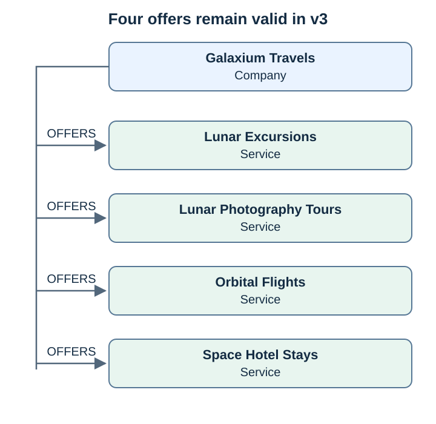
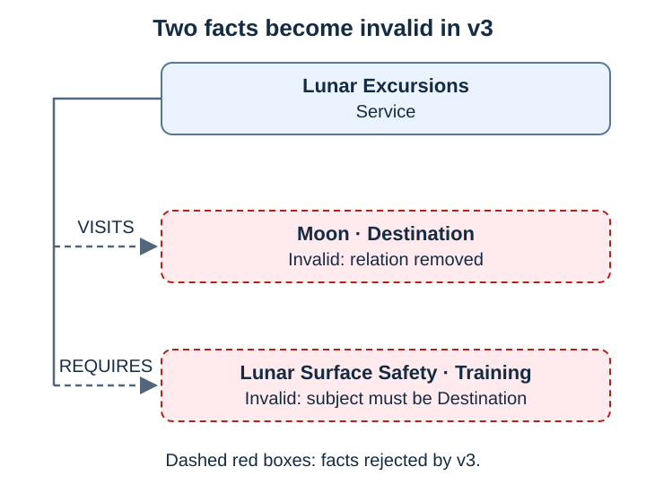

# Lab 9: Breaking ontology change

[← Lab 8](08-all-questions.md) · [Labs](README.md) · Next: [Lab 10](10-ontology-impact-analysis.md)

**Goal:** change the *meaning* of existing relationships, not just add new ones, and find out which stored facts become invalid. The graph does not change in this lab.

| | Before | After |
| --- | --- | --- |
| Active ontology | 2 | 2 |
| Proposed definition | — | [v3-breaking.json](../data/scenarios/breaking-change/v3-breaking.json) (`extends: "2"`, not activated) |
| Facts | 6 | 6 (2 of them invalid under v3) |

Lab 5 added things (v1 → v2). This lab models two business decisions that **change** v2:

| Decision | Change in v3 | Kind of change |
| --- | --- | --- |
| "We say *travels to*, not *visits*" | `VISITS` removed, `TRAVELS_TO: Service → Destination` added | Rename (= remove + add) |
| "Safety training belongs to the destination, not the product" | `REQUIRES: Service → Training` becomes `REQUIRES: Destination → Training` | Same name, new meaning |

```json
{ "version": "3", "status": "approved", "extends": "2",
  "entity_types": ["Company", "Destination", "Service", "Training"],
  "relations": { "OFFERS": ["Company", "Service"], "TRAVELS_TO": ["Service", "Destination"],
                 "REQUIRES": ["Destination", "Training"] } }
```

The scenario is marked `approved` on purpose: the migration in Step 2 is refused for its **content**, not for its status.

## Step 1: Compare v2 with v3

```bash
.venv/bin/graphrag ontology-diff data/ontologies/v2.json data/scenarios/breaking-change/v3-breaking.json
```

**Expected result:**

```json
{
  "from": "2",
  "to": "3",
  "added_types": [],
  "removed_types": [],
  "added_relations": { "TRAVELS_TO": ["Service", "Destination"] },
  "removed_relations": ["VISITS"],
  "changed_relations": { "REQUIRES": { "from": ["Service", "Training"], "to": ["Destination", "Training"] } },
  "unchanged_relations": ["OFFERS"],
  "compatible": false
}
```

The diff already says the change is breaking (`compatible: false`). It does not say **which data** breaks.

## Step 2: Try to migrate

```bash
.venv/bin/graphrag migrate --ontology data/scenarios/breaking-change/v3-breaking.json
```

**Expected result:** exit code 1 and:

```text
Migration refused: Only additive migrations are supported; removed or changed definitions need a rebuild
```

The migration is refused before anything is relabelled, so even the plan is refused. Insertion rule 7 protects the graph from a relabel that would leave facts which no longer mean what the ontology says.

## Step 3: Which facts become invalid?

[lab_fact_check.py](../scripts/lab_fact_check.py) reads the current revision snapshot of every stored document (read-only). It checks each fact against the new definition with the same rules as `validate`, but it reports **every** violation instead of stopping at the first one:

```bash
.venv/bin/python scripts/lab_fact_check.py --ontology data/scenarios/breaking-change/v3-breaking.json
```

**Expected result:** exit code 1 and:

```json
{
  "ontology": "3",
  "valid": [
    "galaxium OFFERS lunar-excursions  [company-overview]",
    "galaxium OFFERS lunar-photography-tours  [company-overview]",
    "galaxium OFFERS orbital-flights  [company-overview]",
    "galaxium OFFERS space-hotel-stays  [company-overview]"
  ],
  "invalid": [
    { "fact": "lunar-excursions REQUIRES lunar-surface-safety  [lunar-training-policy]",
      "reason": "REQUIRES now connects Destination -> Training; this fact connects Service -> Training" },
    { "fact": "lunar-excursions VISITS moon  [lunar-itinerary]",
      "reason": "relation VISITS removed" }
  ]
}
```

The same six stored facts, checked against v3.

**Still valid (4 facts):** `OFFERS` is unchanged in v3.



**Invalid (2 facts):** both start at the Service `lunar-excursions`.



- **`VISITS`** no longer exists in v3. The fact has no relation left to belong to.
- **`REQUIRES`** still exists, but v3 only allows it from a `Destination`. The stored fact starts at a `Service` (`lunar-excursions`), so its endpoints no longer match.

Control run against the active definition:

```bash
.venv/bin/python scripts/lab_fact_check.py --ontology data/ontologies/v2.json
```

**Expected result:** exit code 0, six valid facts, `"invalid": []`.

## Step 4: Why the two invalid facts are different problems

| Fact | Why invalid | Can it be converted automatically? |
| --- | --- | --- |
| `lunar-excursions VISITS moon` | Relation removed | **Yes, with approval.** `TRAVELS_TO` has the same endpoints and the same meaning. Rewriting `VISITS` → `TRAVELS_TO` loses nothing. |
| `lunar-excursions REQUIRES lunar-surface-safety` | Same name, new endpoints | **No.** The source says *"Lunar Excursions requires … training"*. Turning this into `moon REQUIRES lunar-surface-safety` would state something no source says. It must be re-extracted, and the policy may need rewording first. |

A name change is mechanical. A change of meaning needs the **source**, not the old fact.

## Step 5: A change the diff cannot see

Suppose v3 kept `REQUIRES: Service → Training` but the business redefined it as *"recommended, not mandatory"*. Then `ontology-diff` reports `compatible: true`, the migration runs, and every `REQUIRES` fact silently means something its source never said.

The ontology files store **structure** (types and endpoints). They do not store meaning. A meaning change without a structural change must be caught in review: for example, rename the relation (`RECOMMENDS`) so that it *becomes* structural and shows up in the diff.

## Step 6: Confirm nothing changed

```bash
.venv/bin/graphrag inspect
```

**Expected result:** ontology `2`, three documents, six facts, exactly as after Lab 8.

## Check yourself

- [ ] `compatible: false`; the migration was refused with exit code 1.
- [ ] Two facts are invalid, for two different reasons.
- [ ] You can explain why `VISITS` can be renamed mechanically but `REQUIRES` cannot.

<details>
<summary><b>Show answers</b></summary>

1. Removing VISITS and changing REQUIRES makes the diff incompatible; migration stops before writing.
2. VISITS is absent in v3; REQUIRES now needs a Destination subject instead of a Service.
3. In this scenario the VISITS rename preserves meaning. Moving the training requirement to Moon would invent a claim absent from the source.

</details>
