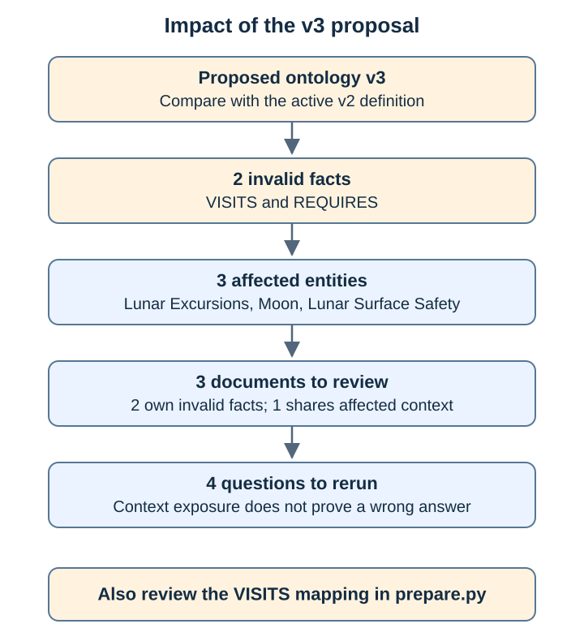
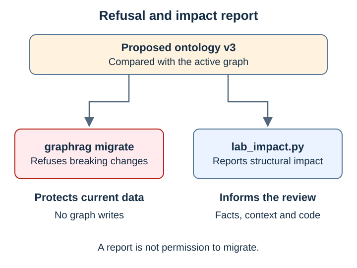
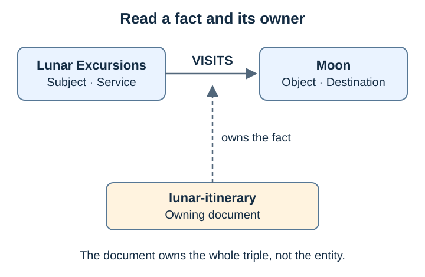
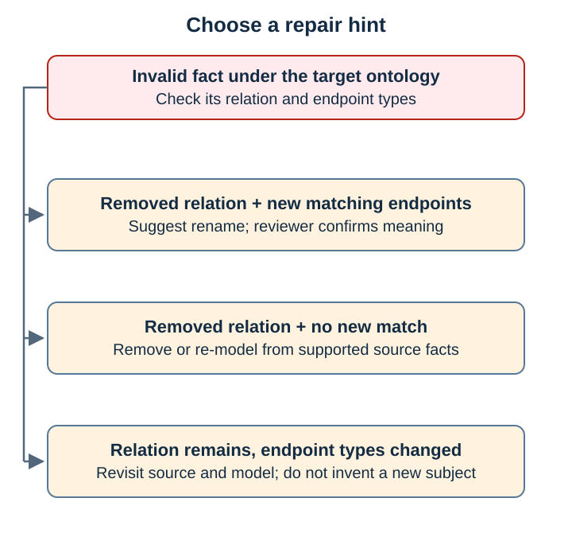
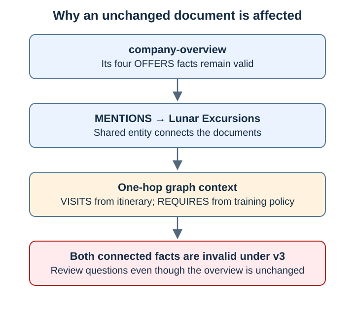
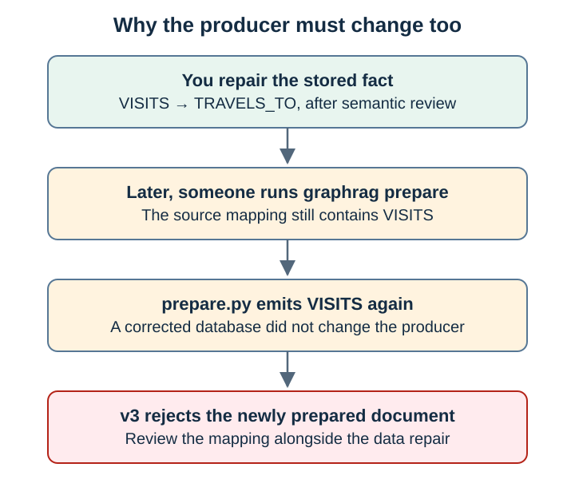

# Lab 10: Ontology impact analysis

[← Lab 9](09-breaking-ontology-change.md) · [Labs](README.md) · Next: [Lab 11](11-ai-assisted-relationship-discovery.md)

**Goal:** report the structural impact of the v3 proposal before deciding how to repair or rebuild. Start after Lab 9: active ontology v2, three documents, six facts. This lab changes no graph data.

A migration refusal protects the current graph. An impact report identifies facts and documents to review, questions to rerun, and code references to inspect.





## How the analysis works

[lab_impact.py](../scripts/lab_impact.py) reads current revision snapshots. It uses rules for the ontology checks and the embedding model for question retrieval; it never calls the chat model. `--no-questions` needs Neo4j only.

| Level | Check | Limit |
| --- | --- | --- |
| Facts | Types exist, relation exists, endpoint types match | Cannot detect meaning changes that preserve structure |
| Repair hints | Suggest a new relation with matching endpoints, or source review | Matching types do not establish equivalent meaning |
| Entities | Removed types and endpoints of invalid facts | Describes structural impact |
| Documents | Own invalid facts, or mention affected entities | Shared entities can change context across documents |
| Questions | Search and expand; flag invalid facts in returned context | Flags exposure, not a demonstrated answer change |
| Code | Whole-word search for removed/changed relation names under `src/` | References can include comments; dynamic uses and other folders can be missed |

## Step 1: Run the report

```bash
.venv/bin/python scripts/lab_impact.py --ontology data/scenarios/breaking-change/v3-breaking.json
```

**Expected result:** exit code 1 (impact found). With the recorded retrieval, the summary is:

```json
{
  "documents": 3,
  "documents_to_re_extract": 2,
  "documents_with_changed_context": 1,
  "facts": 6,
  "facts_invalid": 2,
  "entities_affected": 3,
  "questions_affected": 4
}
```

The four OFFERS facts remain valid. Read `facts`, `entities`, `documents`, `questions` and `code_references` to trace each summary count.



## Step 2: Interpret the repairs

| Invalid fact | Why v3 rejects it | Review action |
| --- | --- | --- |
| `lunar-excursions VISITS moon` | VISITS removed; TRAVELS_TO added with the same endpoint types | Confirm equivalent meaning before approving a rename |
| `lunar-excursions REQUIRES lunar-surface-safety` | REQUIRES now starts at Destination, not Service | Revisit the source and model; a rename cannot fix the subject type |



The source says **Lunar Excursions** requires training. Replacing its subject with **Moon** would assert something the source does not say. A changed ontology can make the old source impossible to represent faithfully; source review must not invent a new claim to make it fit.

The affected entities are `lunar-excursions`, `moon` and `lunar-surface-safety`. Their document impact is:

| Document | Own invalid fact? | Action |
| --- | --- | --- |
| `lunar-itinerary` | VISITS | Review mapping and rebuild with the agreed relation |
| `lunar-training-policy` | REQUIRES | Review source/model compatibility |
| `company-overview` | No | Review answers: its shared Lunar Excursions entity reaches the invalid facts |



## Step 3: Inspect questions and code

Q1, Q3 and Q4 use the changed relations. Q2 needs only OFFERS, which remains valid, but can receive invalid facts as extra context. All four were flagged in the recorded run. This identifies questions to rerun; it does not predict the LLM's answer.

`code_references` includes `src/local_graphrag/prepare.py:61`, where the mapping creates VISITS. Repairing stored data alone would leave `prepare` producing the old relation on the next run. Review the producer as well as the data. No code is changed in this lab.



## Step 4: Control run

```bash
.venv/bin/python scripts/lab_impact.py --ontology data/ontologies/v2.json --no-questions
```

**Expected result:** exit code 0; zero invalid facts and affected entities; empty `entities` and `code_references`. The `migration` field repeats the importer's verdict: `refused by graphrag migrate: Graph is already on ontology 2`. No structural impact does not mean migration approval.

## Step 5: Stop on impact

```bash
mkdir -p .runtime/lab-10
.venv/bin/python scripts/lab_impact.py --ontology data/scenarios/breaking-change/v3-breaking.json --no-questions \
  > .runtime/lab-10/impact.json \
  && .venv/bin/graphrag migrate --ontology data/scenarios/breaking-change/v3-breaking.json --apply
```

**Expected result:** exit code 1, report saved, migration never called. `&&` proceeds only after exit code 0. The importer still enforces its own approval, successor-version and additive-change checks if called. This report is an extra review aid; it is not a complete migration safety check. A breaking change to definitions that no current fact uses still exits 1, because the ontology diff is not compatible.

```bash
.venv/bin/graphrag inspect
```

**Expected result:** ontology 2, three documents, six facts.

## Check yourself

- [ ] Explain why company-overview is affected although its OFFERS facts remain valid.
- [ ] Explain why a rename hint needs semantic review.
- [ ] Explain why a question receiving an invalid fact is not proof of a wrong answer.
- [ ] Confirm that the v3 gate stopped and the graph stayed unchanged.

<details>
<summary><b>Show answers</b></summary>

1. It mentions Lunar Excursions, whose adjacent VISITS and REQUIRES facts come from other documents.
2. Matching endpoint types show structural compatibility; they do not prove that two relation names mean the same thing.
3. A question can receive unrelated extra context. Q2 needs only the unchanged OFFERS facts. Inspect traces and answers to assess actual effects.
4. Exit code 1 prevents the command after `&&`; `inspect` still reports v2 and six facts.

</details>
