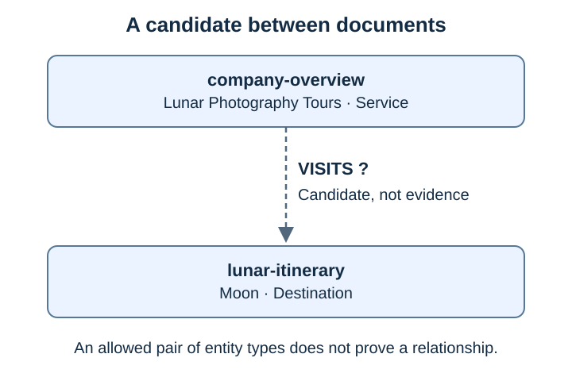
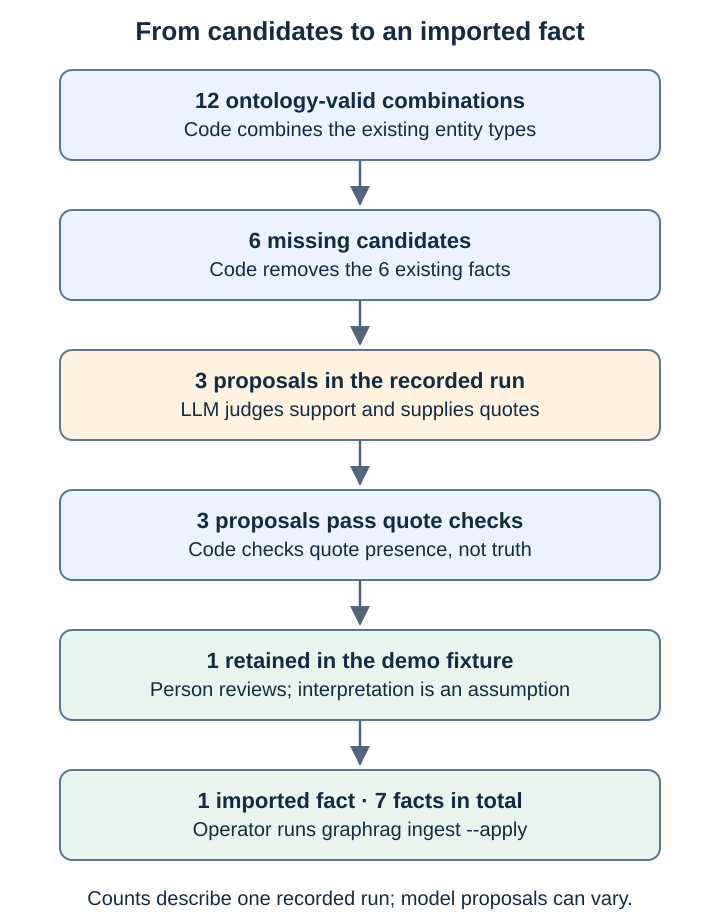
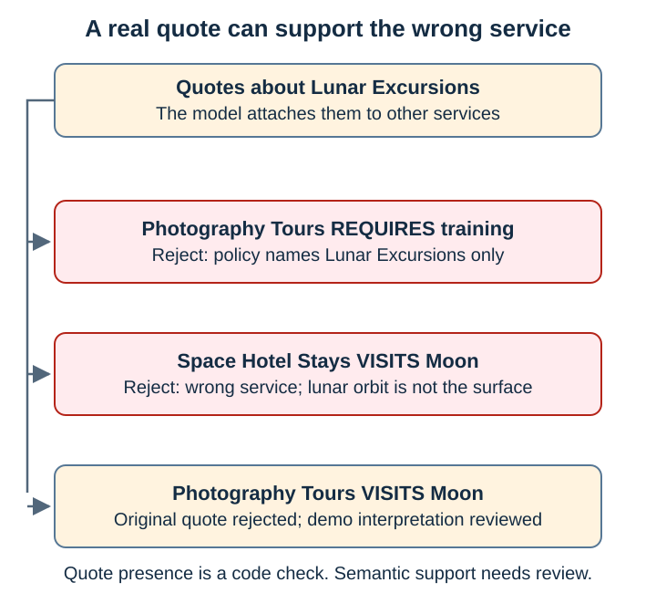
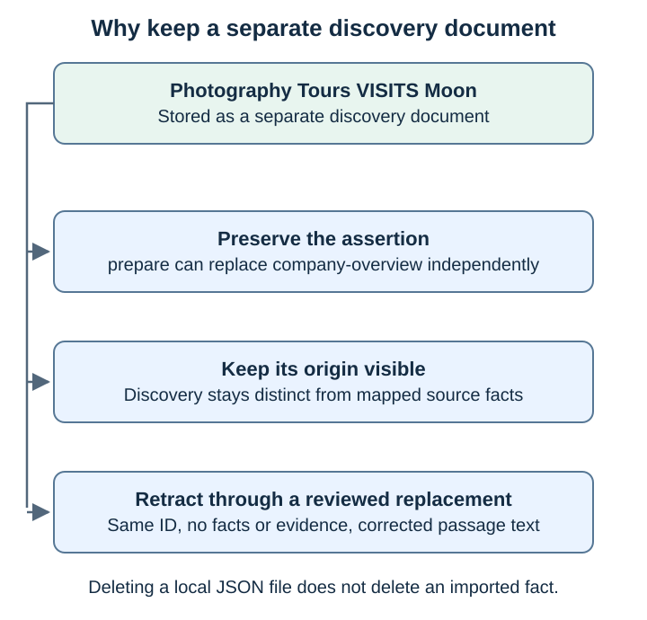
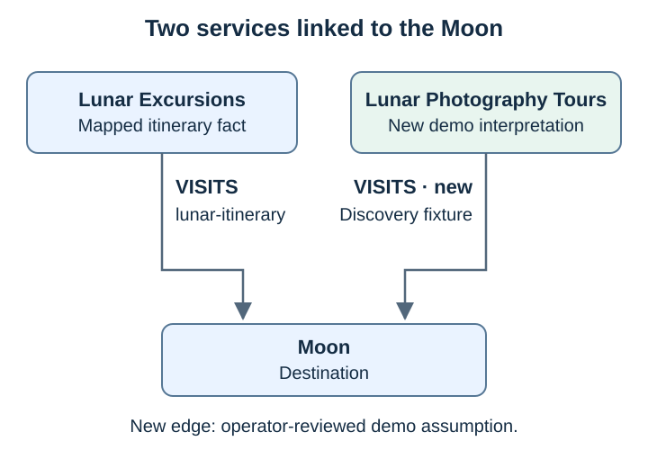

# Lab 11: AI-assisted relationship discovery

[← Lab 10](10-ontology-impact-analysis.md) · [Labs](README.md) · Next: [Lab 12](12-validation-and-regression.md)

**Goal:** let the local LLM look **across documents** for facts the graph does not have yet. Its suggestions are then checked by code and by a person before anything is imported.

| | Before | After |
| --- | --- | --- |
| Active ontology | 2 | 2 |
| Documents | 3 | 4 (+ `discovered-lunar-photography-tours-visits-moon`, revision `0c4b479b4a38`) |
| Facts | 6 | **7** |
| New question | — | Q4 *"Which services take customers to the Moon?"* |

## The problem: some facts span two documents

Until now, every fact came from **one** document: either from `prepare` (fixed mapping code) or from a hand-written file. A fact that needs **two** documents to be seen was never created.

The overview describes Lunar Photography Tours, while the typed `moon` entity is declared in the itinerary. The script can propose a link between them; whether the source supports it still needs review.



This lab lets the LLM read **all** documents together and suggest such missing facts.

## The idea in one picture: a funnel

The LLM does not get free rein. Its suggestions pass through a funnel. Each stage removes suggestions, and only one fact reaches the graph:



| Stage | Who decides | What happens |
| --- | --- | --- |
| 1. Candidates | **Code** (rules) | List every fact the active ontology allows between the stored entities that does not exist yet |
| 2. Judgement | **LLM** (`qwen3:8b`, temperature 0, seed 42, prompt `discovery-v1`) | For each candidate: is it supported? If yes, it must give an exact quote and the document it comes from |
| 3. Gates | **Code** (rules) | Drop candidates the LLM invented, unknown documents, and quotes that do not appear word for word in the cited document |
| 4. Review | **You** | Decide whether the quote really supports the fact |
| 5. Import | `graphrag ingest` | The reviewed fact goes through all the normal insertion rules |

**The most important rule:** the gates reject proposals outside the candidates created by code. The model can still emit malformed or incomplete output; it has no authority to add entities, types or relations. The script [lab_discover.py](../scripts/lab_discover.py) reads the graph but never writes to it.

## Step 1: List the candidates (no LLM)

```bash
.venv/bin/python scripts/lab_discover.py --slots-only
```

`--slots-only` stops after stage 1. No LLM is called. (In the script and its output, a candidate is called a **slot**: an empty place that a fact could fill.)

**Expected result:**

```json
{
  "ontology": "2",
  "slots": [
    "lunar-photography-tours REQUIRES lunar-surface-safety",
    "orbital-flights REQUIRES lunar-surface-safety",
    "space-hotel-stays REQUIRES lunar-surface-safety",
    "lunar-photography-tours VISITS moon",
    "orbital-flights VISITS moon",
    "space-hotel-stays VISITS moon"
  ]
}
```

**Where do the 6 candidates come from?** The code takes each relation of ontology v2 and combines every entity of the right types:

| Relation in v2 | Combinations | Already a fact | Candidates |
| --- | --- | --- | --- |
| `OFFERS: Company → Service` | 1 company × 4 services = 4 | 4 | **0** |
| `VISITS: Service → Destination` | 4 services × 1 destination (`moon`) = 4 | 1 (`lunar-excursions`) | **3** |
| `REQUIRES: Service → Training` | 4 services × 1 training (`lunar-surface-safety`) = 4 | 1 (`lunar-excursions`) | **3** |
| **Total** | **12** | **6** | **6** |

These 6 are the only questions the LLM may answer.

## Step 2: Let the LLM judge the candidates

```bash
.venv/bin/python scripts/lab_discover.py --output .runtime/lab-11/proposed
```

This runs all three automatic stages: candidates, LLM, gates. The LLM gets the full text of **all** stored documents plus the list of 6 candidates. For each one, it answers *supported* or *not supported*. If it says *supported*, it must name the document and copy a quote from it.

`--output .runtime/lab-11/proposed` writes **one file per surviving suggestion** into that folder. Each file is a normal document that `graphrag ingest` could import. Nothing is imported automatically, and the graph stays unchanged.

**Recorded result** (about 12 s; suggestions, ordering and wording may differ on your run):

```json
{
  "model": "qwen3:8b",
  "prompt_version": "discovery-v1",
  "ontology": "2",
  "slots": 6,
  "results": [
    { "candidate": "lunar-photography-tours REQUIRES lunar-surface-safety", "status": "proposed: needs human review",
      "document": "lunar-training-policy",
      "quote": "Lunar Excursions requires completion of Lunar Surface Safety training before departure.",
      "cross_document": true },
    { "candidate": "orbital-flights REQUIRES lunar-surface-safety",   "status": "not supported (model)" },
    { "candidate": "space-hotel-stays REQUIRES lunar-surface-safety", "status": "not supported (model)" },
    { "candidate": "lunar-photography-tours VISITS moon", "status": "proposed: needs human review",
      "document": "company-overview", "quote": "Moon surface exploration \u25e6", "cross_document": true },
    { "candidate": "orbital-flights VISITS moon", "status": "not supported (model)" },
    { "candidate": "space-hotel-stays VISITS moon", "status": "proposed: needs human review",
      "document": "company-overview", "quote": "Luxury accommodations in lunar orbit \u25e6", "cross_document": true }
  ],
  "unanswered_slots": [],
  "written": [
    ".runtime/lab-11/proposed/discovered-lunar-photography-tours-requires-lunar-surface-safety.json",
    ".runtime/lab-11/proposed/discovered-lunar-photography-tours-visits-moon.json",
    ".runtime/lab-11/proposed/discovered-space-hotel-stays-visits-moon.json"
  ],
  "graph": "unchanged; review the proposals, then plan them with ./scripts/ingest.sh"
}
```

**How to read the result**

| Field | Meaning |
| --- | --- |
| `status: "not supported (model)"` | The LLM said no. The candidate is dropped |
| `status: "proposed: needs human review"` | The LLM said yes **and** the code checks passed. A person must now decide |
| `status: "rejected: …"` | The LLM said yes, but a code check failed (none in this run) |
| `document`, `quote` | The evidence the LLM gives for its yes. `\u25e6` is how JSON writes the character `◦` (a list bullet copied from the source text) |
| `cross_document: true` | At least one endpoint is absent from the cited document's entity list; this does not prove that multiple documents support the fact |
| `unanswered_slots` | Candidates the LLM skipped. Empty here: it answered all 6 |
| `written` | The files created by `--output`, one per proposal |

**Result:** the LLM said *yes* to 3 of 6 candidates. All 3 passed the code checks: each quote really appears, word for word, in the cited document.

The 3 files are valid documents, so `ingest` would accept all three. Check it with a plan (without `--apply`, nothing is imported):

```bash
./scripts/ingest.sh --data .runtime/lab-11/proposed      # plan only, do NOT apply
```

**Expected result:** three `"action": "create"` entries, each with one added fact. Format, ontology and quote checks all pass. **Do not apply this**: the next step shows that two of the three are wrong.

## Step 3: Review the proposals

The code checked that each quote **exists**. It did not check what the quote is **about**. That is your job now.

Look at where each quote really comes from. All three come from the text about **Lunar Excursions**, not from the service the LLM linked them to:

| Proposal | Where the quote really comes from | Decision |
| --- | --- | --- |
| Lunar Photography Tours REQUIRES Lunar Surface Safety | The training policy for **Lunar Excursions** | **Reject.** The policy names only one service. "Both are lunar" is not evidence |
| Space Hotel Stays VISITS Moon | The **Lunar Excursions** text (*"Luxury accommodations in lunar orbit"*) | **Reject.** Wrong service. And the hotel is described as *in orbit*, not on the Moon |
| Lunar Photography Tours VISITS Moon | The **Lunar Excursions** text (*"Moon surface exploration"*) | **Accept the fact, but replace the quote.** The tour's own line says *"Guided lunar photography experience"*. That is the better evidence |



The LLM found the right **topic** (the Moon, lunar training), but linked it to the wrong **service**. The code checks cannot catch this: they test whether the text exists, not what it means. That is why stage 4 is a person.

The third decision is a judgement call. *"Lunar photography"* could also mean taking photos of the Moon from orbit. The checked-in fixture assumes that the tour takes customers to the Moon for this synthetic example. The quoted line does not establish that interpretation uniquely. If you reject this assumption, skip the import and expect the supplied Lab 12 reference to differ.

## Step 4: Import the reviewed fact

The reviewed version is already in the repository: [discovered-lunar-photography-tours-visits-moon.json](../data/scenarios/relationship-discovery/reviewed/discovered-lunar-photography-tours-visits-moon.json). It uses the same document format with a different quote and is supplied as a curated demo fixture. Generated proposals say *"Proposed by the discovery script from the stored documents; not reviewed."* The supplied fixture replaces that sentence. This label is not an importer approval check; decide whether to accept the assumption before importing. Compare it with the LLM's version:

```bash
diff .runtime/lab-11/proposed/discovered-lunar-photography-tours-visits-moon.json \
  data/scenarios/relationship-discovery/reviewed/discovered-lunar-photography-tours-visits-moon.json
```

**Expected difference:** in `text`, *"Proposed by the discovery script …; not reviewed."* becomes *"Discovered across the stored documents and reviewed by a person."*. The evidence changes from `Moon surface exploration ◦` to `Guided lunar photography experience` in both `text` and `evidence[0].quote`. The relation stays the same. After a fresh model run other differences are possible.

Now validate it, plan it, import it, and check that a second import changes nothing:

```bash
.venv/bin/graphrag validate --data data/scenarios/relationship-discovery/reviewed --ontology data/ontologies/v2.json
./scripts/ingest.sh --data data/scenarios/relationship-discovery/reviewed            # plan
./scripts/ingest.sh --data data/scenarios/relationship-discovery/reviewed --apply    # import
./scripts/ingest.sh --data data/scenarios/relationship-discovery/reviewed            # repeat: unchanged
.venv/bin/graphrag inspect
```

**Expected result:**

| Command | Result |
| --- | --- |
| `validate` | `Validated 1 documents` |
| First plan | Creates `discovered-lunar-photography-tours-visits-moon` with `added_facts: ["lunar-photography-tours VISITS moon"]` |
| Repeated plan | `unchanged` |
| `inspect` | Four documents, seven facts |

In the `inspect` output:

```text
discovered-lunar-photography-tours-visits-moon  ontology_version 2  revision 0c4b479b4a38  revisions 1

lunar-photography-tours VISITS moon  [discovered-lunar-photography-tours-visits-moon]
```

No new entities were created (`entity_types` is still `Service: 4`, `Destination: 1`). The new document reuses the existing entities `lunar-photography-tours` and `moon` with exactly the same names and types. A different name would have been rejected as a conflict.

**Why a separate document?** A later `prepare` run would overwrite an edit to company-overview. A separate document also keeps the discovery assertion distinct from mapped source facts. There is no document-deletion command: removing its JSON file does not remove an imported fact. To retract it with the existing importer, plan and apply a replacement of the same document ID with `facts: []`, `evidence: []` and corrected passage text, then rerun regression; the document and history remain. A full demo reset/rebuild is another option.



## Step 5: Ask the new question (Q4)

```bash
.venv/bin/graphrag search "Which services take customers to the Moon?"
.venv/bin/graphrag ask --trace "Which services take customers to the Moon? Cite your sources."
```

**Expected result** of `search`:

```text
company-overview 0.864
    … 4 × OFFERS,
    Lunar Photography Tours VISITS Moon [discovered-lunar-photography-tours-visits-moon]
    Lunar Excursions VISITS Moon [lunar-itinerary]
    Lunar Excursions REQUIRES Lunar Surface Safety [lunar-training-policy]
discovered-lunar-photography-tours-visits-moon 0.842
lunar-itinerary 0.835
```

Recorded answer: **Lunar Excursions** and **Lunar Photography Tours**, citing `lunar-itinerary`, `company-overview` and `discovered-lunar-photography-tours-visits-moon`.

Before this lab, only **one** service led to the Moon. Now there are two:



## Side effect: rankings for old questions change

Run the search for Q1 again:

```bash
.venv/bin/graphrag search "Which destination can Galaxium Travels customers visit?"
```

**Expected result:** `company-overview` 0.859, `lunar-itinerary` 0.851, `discovered-lunar-photography-tours-visits-moon` 0.787. The training policy (0.749) has dropped out of the top 3.

Search returns the top 3 documents. The new document now takes one of these three places, so a different document drops out. **Every new document can change the answers to old questions.** That is why Lab 12 checks all of them again.

## Check yourself

- [ ] You can explain where the 6 candidates come from, and why `OFFERS` has none.
- [ ] You can follow the funnel: 6 candidates → 3 suggested by the LLM → 3 pass the code checks → 1 accepted by you → 7 facts in the graph.
- [ ] You can explain why all three suggestions passed the code checks, but two of them were still wrong.
- [ ] The new fact belongs to its own document, and you can name the three reasons why.

<details>
<summary><b>Show answers</b></summary>

1. OFFERS has no missing combinations; VISITS has three and REQUIRES has three.
2. In the recorded run: six candidates → three proposals → three valid quotes → one demo assumption accepted → seven facts.
3. Quote matching tests presence, not whether the quote describes the proposed service.
4. A separate document avoids prepare overwrites, distinguishes the assertion’s origin and allows retraction by replacing its facts.

</details>
